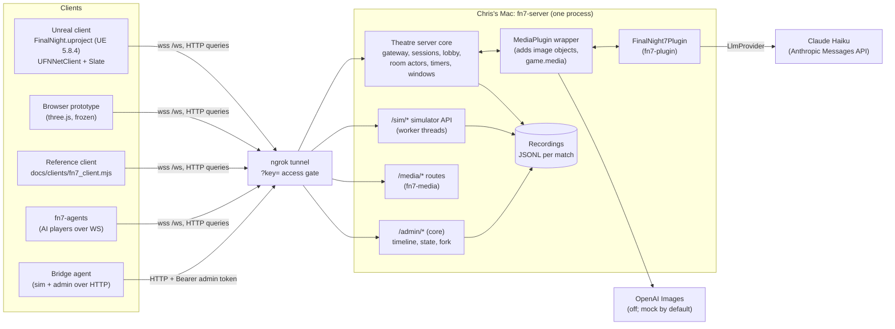
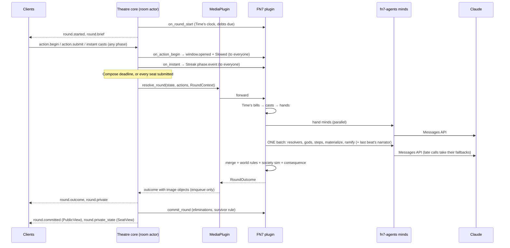
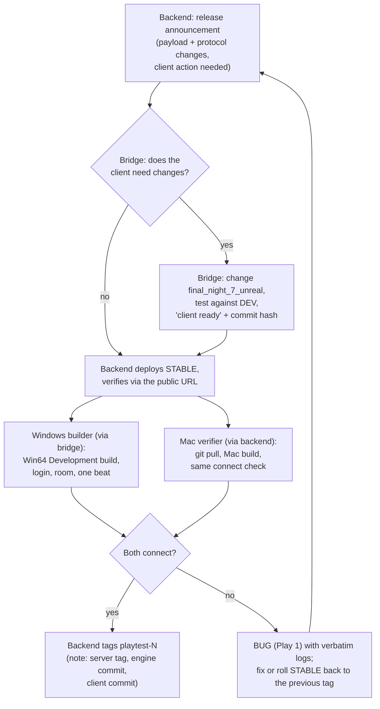

# Final Night 7 on The Theatre: the total project guide

This is the one document to read first. It covers the whole project, from the designers' intent to the code, the
servers, the team and what is still open, so that a newcomer (a person or an agent) can pick the project up without
any earlier conversation. Each section links to the detailed document it summarizes. When this guide and a detailed
document disagree, **the code wins, then the detailed document**. Tell the backend session so this guide gets fixed.

- **Written:** 2026-11-14, against `Aftersource/final_night_7` at `3fa3f6b`, `Aftersource/theatre` at `9d98b98`, and
  the release tags `playtest-1` and `playtest-2`.
- **Labels:** **[uncertain]** marks anything this guide could not confirm from a file or a commit. **[stale doc]**
  marks a place where a source document is known to be out of date (all of these are listed in §11.3).
- **Paths:** paths are relative to `~/Desktop/source/aftersource/final_night_7/` unless they start with `theatre/`
  (`~/Desktop/source/aftersource/theatre/`) or name another repo.

---

## Contents
1. [What this is](#1-what-this-is)
2. [The vision, in the designers' words](#2-the-vision-in-the-designers-words)
3. [The game rules as built](#3-the-game-rules-as-built)
4. [Architecture, back to front](#4-architecture-back-to-front)
5. [Data](#5-data)
6. [APIs](#6-apis)
7. [Media](#7-media)
8. [Operations](#8-operations)
9. [Team and process](#9-team-and-process)
10. [History and status](#10-history-and-status)
11. [Open items and pending decisions](#11-open-items-and-pending-decisions)
12. [Glossary](#12-glossary)
13. [Document map](#13-document-map)

---

## 1. What this is

**Final Night 7 (FN7)** is the team's entry to the **Epic AI MegaJam 2026**. It's a real-time battle royale of
demigods across the whole planet. Each player commands two LLM orchestrators (their "hands"), a pantheon of god agents
rules on anything divine, and a simulated society of crowds, mobs, armies and named people reacts to all of it. It's
"7" because 7 (BUILDLOG, 2026-11-13).

The project has two parts:

| Part | What it is | Repo |
|---|---|---|
| **The Theatre** | A general-purpose, server-authoritative multiplayer engine for games where players act in natural language and an LLM decides what happens. It provides rooms, a lobby, timed phases, real-time action windows and instant actions, recording, game queries, and an admin API for fork and replay. It knows nothing about any one game. | `Aftersource/theatre` (owned by the `theatre_worker` session) |
| **Final Night 7** | The game: a Theatre `GamePlugin` written in Rust, plus a server binary (`fn7-server`) that bundles the Theatre server, the plugin, image generation and a simulator API. | `Aftersource/final_night_7` (the backend) |
| Unreal client | The game client players see. UE 5.8.4, `FinalNight.uproject`, Slate C++ UI, Win64 as the shipped platform. | `Aftersource/final_night_7_unreal` |
| Browser prototype | A three.js globe-table client. Frozen. | `Aftersource/final_night_7_web` |

The designer was explicit about this split: the project makes a theatre first, and then the game is Final Night 7
(BUILDLOG, 2026-11-14, "the platform is The Theatre").

**Jam constraints:**
- The jam deliverable is a **packaged Unreal build**. The jam is Unreal/UEFN only; the brother's frontend is the
  Unreal client.
- **Deadline: Nov 15 2026, 8:59 PM EST.** After **Nov 15, 12:00 PM EST** only blocking fixes ship (`docs/PLAYBOOK.md`
  §6).
- Gameplay must be built during the contest. Prior work is disclosed: the 2024 Final Night prototype (Node backend and
  Unity client) and Final Night 2.5 (the earlier Theatre plugin). See `planningnight/BROTHER_HANDOFF.md` ("list it as
  pre-jam material in the submission").
- **No LLM key ever ships in the client.** All LLM work runs on the server (`final_night_7_unreal/README.md`,
  `theatre/DEPLOY.md`).

---

## 2. The vision, in the designers' words

`BUILDLOG.md` holds the designers' words verbatim (spelling fixed only), newest last. **It is the source of intent:
everything built must trace back to an entry there.** The quotes below are short excerpts. Read the full log before
changing any rule.

### 2.1 Demigods and their hands (orchestrators)
> "assume that we have 4 players with their left and right hands, and those are two orchestrators ... final night 7 is
> a game of orchestrators. NOW it's literally as fast as you can type / yell / speak ... your orchestrators are like
> demigods" (2026-11-13, "the sequel")

Each player is a demigod. You never steer a body directly. You give orders to your **Left** and **Right** hands, which
are LLM orchestrators: they break orders into acts, spawn **subagents**, possess people, raise armies and invoke gods.
You can zoom from the planet down to one person and micromanage them (`DESIGN.md` §1).

### 2.2 Gods and paladins
> "if the demigod needs to travel through time or slow time, the god of time intervenes. so like imagine the d&d gods
> right, their paladins etc etc." (2026-11-13, "orchestrators, gods, memory")

Reality is run by a pantheon of **seven god agents**: Time, Nature, Consequence, Death, Chance, Memory and Entropy.
When a demigod reaches into a god's domain, that god's mind grants, refuses, bargains or twists, names a price, and
may send a **paladin** (a god-serving person with a body in the world). The pantheon is data (`data/pantheon.json`).

### 2.3 Time and Entropy: two separate superpowers
This is the core of the design, and the designer reaffirmed it late on 2026-11-14 as the primary design.

**Text entry is the God of Time interaction.**
> "user types in information, time slows down for 30 seconds for all players ... the other gods see who does it, but
> nobody can see if the other god ENGAGES or not ... enter pressed, all other text boxes and wills of the other gods DO
> NOT GO THROUGH if the first god presses enter too fast" (2026-11-13)

> "the text-entry is the god of time interaction, that's the thing where their words make the demigods change the
> course of history, so it's separate from lightning bolt powers" (2026-11-13)

**Bolts are the god-power currency, and Entropy always says yes.**
> "throws thunderbolts but gives all other gods 2 thunderbolts as the god of entropy is like 'yes yes use infinite
> magic power ahahhaahhaaa'" (2026-11-13)

> "god-of-entropy always just 'says yes' ... an external llm that can then tell the ramifications to the world, you can
> use a '10 ramifications' ... todo persistent mods" (2026-11-13)

> "lightning bolt is just the thing that's the icon of the power ... it could be clouds, volcanos ... think 'magic
> carpet' from the 90's" (2026-11-13)

What that means in the game:
- **Typing slows time** for everyone for up to 30 seconds. Everyone is told who did it. Nobody learns who else is
  typing. The first typist's Enter **cuts off** everyone slower.
- **Casting** is a separate UX path: a power from a palette (lightning, volcano, flood and so on) thrown anywhere on the
  globe, paid in **lightning bolts**. Every bolt anyone spends on a cast or a god gives **every rival +2 bolts** (the
  bolt Time takes for orders doesn't, since rules 0.6.0).
- Every cast gets **Entropy's check, which always says yes**. Then an LLM writes **ramifications** ("N ramifications in
  <place> with <context>", N up to 10). Those leave geotagged events and **persistent world mods**.
- Typed text never casts, and casts never carry orders.

### 2.4 The planet
> "let's say its the entire planet your demigods will do everything they can and your left and right hands can summon
> armies" (2026-11-13)

The arena is the whole Earth: UN subregions, each with its largest cities. Every event is geotagged, so the globe can
animate it and recolor by each demigod's influence.

### 2.5 The hierarchical society
> "where's the hierarchical crowd simulation, the mobs, the exact detail on specific petty humans the demigods use as
> generals" (2026-11-13, "the society must be simulated, not scenery")

> "society is a giant table of consequence and venn diagrams, characters are like wherever as large or small clusters,
> once addressed they're memorized" (2026-11-13)

- **Lazy individuality.** Most people exist only as crowds until someone addresses one, who is then **memorized**
  forever.
- **Hierarchy.** planet → region → city → district → crowd → cell → person, every level simulated by rules every beat.
- **Mobs** form from mood thresholds under ringleaders. **Generals** command armies by their own judgment and can
  misread orders, mutiny or defect.

### 2.6 The table
> "a floating globe in the center ... they can select a part of the board, which happens to be a great circle on the
> sphere ... The table should have basically a circle of action ... with like a fog or maybe drifting edges"
> (2026-11-14, "the globe table", spoken)

> "my brother first of all needs to have on-screen the portraits and dioramas of the two demigods ... abstract
> silhouettes of the other 3 players around the table, and if one is human or ai they should have different auras, and
> humans should be able to enter/leave at any point" (2026-11-14)

The client is a tabletop: a globe floating above a board, a selected great circle projected onto the table as a
"circle of action", portraits and dioramas (minifigs) of the demigods, silhouettes of the other players with auras
for human versus AI, and humans joining or leaving at any time.

### 2.7 The 7-minute match
> "a match should feel about 7 minutes, 5-10 depending on how it goes." (Benito, 2026-11-14)

With the LLM on, a beat takes about 7.5 s, so a match is about 55–60 beats. Human rooms use 12 s beats × 30 beats.

### 2.8 The governing principle: the action never waits
> "we're really just separating the player turns from action-thats-happening-as-players-are-directing. as well as some
> nice turn-isms, which don't slow down the action because players are very, very incentivized to do it quickly."
> (2026-11-13)

**The world's action never waits for players.** It runs in continuous flow beats. Player input is an overlay that
feeds the action and never gates it, and every "turn-ism" (slowing time, the Enter cut-off, Time's bill) rewards speed.

---

## 3. The game rules as built

**The rules live in one place: [`docs/DM_RULEBOOK.md`](DM_RULEBOOK.md), the Dungeon Master's rulebook** (rules
**0.8.0**, `RULES_VERSION`; state schema **6**, `STATE_SCHEMA` in `crates/fn7-model/src/lib.rs`). It is written like a
D&D Dungeon Master's Guide and is what the AI DM follows; its core is embedded in the game master's and the gods'
prompts for schema-6 matches. `MECHANICS` in `crates/fn7-plugin/src/lib.rs` is the machine list recorded with every
match. The client contract is `docs/CLIENT_API.md`.

Where each part of the rules went (this section used to hold them):

| Was | Now in the rulebook |
|---|---|
| 3.1 The beat | ch. 17 The beat, the Final Night and winning; ch. 5 Time |
| 3.2 Flow vs slow (text entry) | ch. 12.2 Text entry: Time's slow windows |
| 3.3 Intents and routing | ch. 1 duties, ch. 2 rolls, `MECHANICS` "Intake", "Route" |
| 3.4 Gods and prices | ch. 12.1 The pantheon |
| 3.5 Consequence's debts | ch. 14 Combat, harm and the killers |
| 3.6 Entropy levels and heat death | ch. 12.4 Entropy |
| 3.7 Casts (god powers) | ch. 12.3 Casts; ch. 13 Fault lines |
| 3.8 Armies and command chains | ch. 14 |
| 3.9 Society rules | `MECHANICS` "World rules", `fn7-society/src/sim/mod.rs` |
| 3.10 The Final Night, eliminations, revives | ch. 17, ch. 14 |
| 3.11 Piles and statues | ch. 16, `MECHANICS` "Match ends" |
| 3.12 Hidden information | ch. 15 The table |
| (new in 0.8.0) the governing principle: the Lens and the Engine | ch. 0 |
| (new in 0.8.0) memory, d20, settlements, stories, encounters, loot, day/night, roads, shrines | ch. 2–11 |
| (new in 0.8.0) fault lines, summoning, god-tier powers | ch. 13, 19, 20 |

**Gated on the schema:** rules 0.7.0 read `World::two_bodies()` (schema ≥ 5) and rules 0.8.0 read `World::dm_rules()`
(schema ≥ 6), so schema-4 and schema-5 recordings replay byte for byte (their LLM prompts unchanged).

### 3.13 Settings (knobs) and defaults
Room settings are validated in `crates/fn7-plugin/src/settings.rs`. `GET /sim/settings` lists them, generated from the
validator. **Balance is done with settings, never code** (Play 3).

| Setting | Default | Range | Meaning |
|---|---|---|---|
| `seed` | picked at start | u64 | All randomness |
| `arena` | `planet` | planet \| city | Whole Earth, or one real city |
| `city` | seeded pick | name | Where Time's circle closes (planet), or the arena (city) |
| `players` | 4 | 1–8 | Demigods; the built-in AI plays seats no human holds (synthetic seats ≥ 200) |
| `beats_total` (`rounds`) | 60 | 1–1000 | The Final Night's beat |
| `flow_ms` (`beat_ms`) | 3000 | 500–120000 | Flow beat length; `compose_seconds` defaults to `flow_ms/1000` |
| `slow_ms` | 30000 | 1000–600000 | Longest a slow window stays open |
| `start_bolts` (`bolt_start`) | 1 | 0–99 | Bolts per player at the start (rules 0.7.0) |
| `spark_start`, `bolt_gift`, `spark_gift` | 5, 1, 0 | | Rules 0.7.0: sparks to start; what every other player gains per mega |
| `entropy_per_mega`, `entropy_per_mini` | 10, 1 | | Rules 0.7.0: Entropy per cast |
| `entropy_scale` | 1.0 | 0–10 | Multiplier on every Entropy rise |
| `clusters` | 200 | 8–600 | Crowds created at setup |
| `max_subagents_per_hand` | 3 | 0–10 | Live subagents + possessions per hand |
| `mind_timeout_ms` | 6000 | 50–120000 | Per-call LLM timeout before the fallback |
| `llm` | true | bool | false = never call the LLM |
| `debt_scale` | 0.04 | 0–10 | Consequence's per-act bill multiplier |
| `debt_due_beats` | 50 | 1–100 | Beats until a bill falls due (Time's and Consequence's) |
| `instant_order_debt` | 0.5 | 0–10 | Time's flat debt for a window-less order (R1; §3.2) |
| `arena_close_beats` | 160 | 1–1000 | Beat Time's circle reaches 1,500 km; its own schedule, independent of `beats_total` (R2; §3.10) |
| `accident_scale` | 0.82 | 0–10 | Multiplier on the rules-fallback accident chance (R4) |
| `army_strike_scale` | 0.82 | 0–10 | Multiplier on army strike damage on demigods (R4) |
| `army_first_host_scale` | 0.82 | 0–10 | Multiplier on a first volunteer host's extra chance (R4) |
| `memory_per_owner` | 40 | 4–1000 | Live memories per owner before folding |
| `llm_folds_per_beat` | 2 | 0–32 | Folds written by the LLM per beat |
| `max_intents_per_hand` | 6 | 1–12 | Acts per hand per beat |
| `max_intents_per_window` | 12 | 1–24 | Acts per hand from a window open ≥ `flow_ms` |
| `max_memorize_per_beat` | 6 | 0–64 | People memorized from mentions per beat |
| `max_witnesses` | 4 | 1–64 | Witnesses recorded per act |
| `society_only` | false | bool | The AI demigods give no orders and cast nothing; only the society acts |
| `general_calls_per_beat` | 2 | 0–16 | General-mind LLM calls per beat at decision points |
| `demigods_per_player` | 2 | 1–2 | Rules 0.7.0: two demigods (Left and Right hands, own health each) or one shared body |
| `manifest_scale` | 1.0 | 0–10 | Rules 0.7.0: multiplier on the item engine's tier prices |
| `manifest_muster_scale` | 0.25 | 0–1 | Rules 0.7.0: a manifested host's army footprint (share of `muster_size`) |
| `manifest_calls_per_beat` | 2 | 0–16 | Rules 0.7.0: manifest-mind LLM calls per beat |
| `final_wish_magnitude` | 2 | 0–5 | Rules 0.7.0: magnitude added to every act of the Final Wish (beat 1) |
| `beats_per_day` and the `dm_*` settings | see the rulebook | | Rules 0.8.0: the DM's rulebook (docs/DM_RULEBOOK.md, appendix) |
| `fault_*` | 150 / 1500 km, +3 / −2, ×1.5 / ×1.0, ×1.6 / ×0.6 | | Rules 0.8.0: fault lines for megas (rulebook ch. 13) |
| `compose_seconds`, `resolve_timeout_s`, `choose_seconds` | `flow_ms/1000`, 60, core | core | The core's timers, copied through |
| `first_compose_seconds`, `allow_midmatch_join` | unset, false | core | Core room flags from engine `2d3a43d` / `9d98b98`; passed through by `copy_timer_settings` **[uncertain: not yet exercised by FN7; see §11]** |

**Rooms in use:** the shared lobby is 4 players (2 humans + 2 AI), 30 beats, 12 s flow, LLM on (BUILDLOG "the shared
lobby"; Unreal `Config/DefaultGame.ini`: `MatchRounds=30`, `MatchFlowMs=12000`). The defaults (60 × 3 s, chosen in
`docs/BALANCE_REPORT_2.md`) are the simulator's. A room with a short `beats_total` (the 30-beat lobby) should also set
`arena_close_beats` (for example to its `beats_total`), or Time's circle will be only partly closed on its Final Night.

---

## 4. Architecture, back to front

### 4.1 The whole system



- **Clients** speak the Theatre WebSocket protocol (`theatre/PROTOCOL.md`) plus FN7's payloads
  (`docs/CLIENT_API.md`). They never simulate rules.
- **The ngrok tunnel** exposes the host's port 8080 to the internet. Every request must carry `?key=<KEY>`, or it
  gets `403` (`docs/AGENT_GUIDE.md` §0). The Theatre and the plugin ignore the extra `key` parameter. **[uncertain]**
  The gate itself is configured on the host, outside both repos. Docs are also reachable through the tunnel at
  `/docs/<file>` and on the LAN at port 8081 (a separate static server, not `fn7-server`).
- **`fn7-server`** (`crates/fn7-server/src/main.rs`) is the Theatre server with FN7 compiled in. It calls
  `theatre_server::serve_with(listener, app, fn7_media::http::router(media), signal)` to add routes. It contains:
  - the core (rooms, phases, windows, instant actions, recording, `/admin/*`, `/api/rooms/{code}/query/{name}`,
    `/healthz`, `/stats`)
  - `MediaPlugin` (`src/media.rs`), wrapping `FinalNight7Plugin`: it annotates payloads with image objects and answers
    `game.media`
  - the `/media/*` routes and the `/sim/*` simulator API (`src/simapi.rs`)
- **The LLM** is Claude: the Anthropic Messages API over raw HTTP (`src/anthropic.rs`). The default model is
  `claude-haiku-5-5` (`LLM_DEFAULT_MODEL`), with effort `low` and at most 8 in flight. If `LLM_BASE_URL` is set, the
  core's OpenAI-compatible gateway is used instead. With neither, every mind uses its rules fallback. **Keys live only
  on the server.**
- **Recording** is the core's JSONL (§5.6). `/admin/*` reads it for timeline, state, fork and download. `fn7-sim
  --replay` verifies it.

### 4.2 The engine/plugin boundary
The Theatre owns **when**: timers, seats, sessions, bots, windows, the event log and networking. The plugin owns
**what**: the rules, the views and the summaries (`theatre/DESIGN.md` §5). The plugin state is opaque JSON to the
core. For FN7 that JSON is the whole `fn7_model::World`.

FN7 implements `GamePlugin` (`theatre/PLUGIN_API.md`) through these hooks:

| Hook | FN7 use |
|---|---|
| `validate_settings` | `Settings::validate` (+ `copy_timer_settings`) |
| `on_match_start` | World setup: the planet or a city, crowds, demigods, gods |
| `on_round_start` | Start: Time's clock, due debts, agents expiring, rewind frame, revives |
| `brief` | `round.brief`: arena, gods, powers, entropy, regions, per-seat SeatView |
| `validate_action(.., SubmitKind)` | Field checks; refuses orders in instant actions; checks bolts for casts |
| `on_action_begin(.., next_window_id)` | Opens Time's window (`WindowControl`, closer = the opener, `missing: Drop`) and the `Slowed` event |
| `on_instant` | Returns the public `Streak` |
| `resolve_round(.., ctx: &RoundContext, ..)` | The beat pipeline (§3.1), bills from `ctx.windows_closed` |
| `fallback_outcome(.., ctx)` | A rules-only beat when resolve fails twice or times out |
| `commit_round` | Heat death, eliminations, survivor rule, revives |
| `public_view` / `seat_view` | PublicView / SeatView |
| `queries` / `query` | The `game.*` queries (§6.3) |
| `summarize` | `match.ended.summary`: champions, standings, piles, storyboard, final cut |

**Guardrail:** every wrapper (`MediaPlugin` in the server, `Recorded` in `fn7-sim`) must forward every hook.
`tests/wrappers.rs` asserts this (`docs/ENGINE_SYNC.md` "Guardrails").

### 4.3 Crates
The workspace is `Cargo.toml` at version 0.1.0. Dependencies only ever point down this table (`README.md`). Game
rules never touch I/O. LLM minds never mutate state: they return proposals, and only the merge applies effects.

| Crate | Owns | Key files |
|---|---|---|
| `fn7-model` | Every type, with no logic or I/O: `World`, refs, effects, ledger, memory, hierarchy (`hier.rs`: `Node`, `Cell`, `Mob`, `Level`, `Stance`, `Life`) | `lib.rs`, `refs.rs`, `intent.rs`, `seed.rs` (SplitMix64) |
| `fn7-society` | Deterministic world rules: setup (planet/city from toolkit geography + `data/society_template.json`), mention resolution and memorization, Venn queries, news spread, mood drift, debts, world rules (armies, Entropy, mods), and the **hierarchical simulation** in `src/sim/` (`crowds`, `mobs`, `armies`, `people`, `hier`) | `sim/mod.rs`, `world_rules.rs`, `setup.rs` |
| `fn7-memory` | Memory stores: writes from ledger rows, recall ranked by `about` overlap → salience → recency, folding | `recall.rs`, `fold.rs` |
| `fn7-pantheon` | Gods and powers as data (`data/pantheon.json`, `data/powers.json`, compiled in), keyword routing (whole-word, never stemmed), favor, prices, precedence | `lib.rs` |
| `fn7-agents` | Every LLM mind as a pure `async fn` with a rules fallback: `hand`, `step` (subagents, possessions, paladins), `god`, `resolver`, `narrator`, `materialize`, `fold`, `general`, `ramify`; `runner::run_minds` runs a beat's calls concurrently with timeouts | `lib.rs`, `runner.rs`, `common.rs` (labels: prompts never contain engine ids; player text only in fenced user messages) |
| `fn7-plugin` | The `GamePlugin`: beat loop, merge, flow/slow, casts, views, payloads, queries, visual sheets, storyboard | `lib.rs` (`MECHANICS`), `beat.rs`, `flow.rs`, `casts.rs`, `merge.rs`, `payload.rs`, `phases.rs`, `queries.rs`, `visual.rs`, `settings.rs` |
| `fn7-media` | Images: style config, prompts, generators (mock SVG, OpenAI), disk cache, payload annotation, `/media` routes | `style.rs`, `annotate.rs`, `generator.rs`, `http.rs` |
| `fn7-server` | `fn7-server` (the Theatre server + plugin + media + sim API), `fn7-sim` (in-process matches, replay verification), the Claude backend | `main.rs`, `media.rs`, `simapi.rs`, `record.rs`, `replay.rs`, `anthropic.rs`, `bin/sim.rs` |
| `fn7-tools` | `fn7-agents` (AI players over WebSocket), `fn7-project` (JSONL → SQLite + the `fn7_*` projection), `fn7-schemas` (client JSON Schemas) | `ingest.rs`, `project.rs`, `schemas.rs`, `players.rs` |

**Data files:** `data/pantheon.json` (7 gods), `data/powers.json` (11 powers), `data/society_template.json` (districts,
groups, faiths, clusters, names), `data/media_style.json` (house style). Copies of the first two are served to
clients under `docs/data/`.

### 4.4 How a beat flows through the code



---

## 5. Data

Full detail: `docs/DATA_MODEL.md` **[stale doc: it still describes state schema 3; see §11.3]** and the source of
truth, `crates/fn7-model`.

### 5.1 The World
The whole game is **one `World` value**, the plugin state the Theatre snapshots at each commit. Each table is a `Vec`
indexed by a typed id. Rows are never removed, only marked (dead, dissolved, forgotten, folded), so ids are stable for
the whole match and in every recording.

| Group | Tables |
|---|---|
| Setup and clocks | `meta` (schema, versions, seed, beat, arena, radii, entropy, heat_death, settings), `places` (Earth / regions / cities / quarters, or city / districts / sites) |
| Society | `groups` (Venn sets), `clusters` (crowds; armies are clusters with `army`), `characters` (memorized people, with `Life` sheets for emerged ones), `relations` (trust, fear, debt, loyalty), **schema 4:** `nodes` (one per place, rolled-up totals), `cells` (`ce:`), `mobs` (`mb:`), `battles`, `soc` (society totals) |
| Players | `demigods` (seat, pos, health, hands, bolts, orders, tempo...), `seats` (each seat's zoom and focus), `items` |
| Minds | `agents` (hands, subagents, gods, paladins, possessions), `gods` (favor, attention, health), `rulings`, `intents` |
| Consequence | `ledger` (the table of consequence), `memory`, `pending` (debts due this beat) |
| Planet edition | `mods` (≤ 24 live world mods), `mod_seq`, `slow` (always `None` since engine `faa7220`), `slow_settled`, `out_reported` |
| Time | `rewind` (ring of rewindable fields), `beats` (per-beat records) |

### 5.2 Refs
One reference format everywhere: game state, trace events, SQL and client payloads. `"<prefix>:<n>"`:

| Prefix | Points at | Prefix | Points at |
|---|---|---|---|
| `dg` | demigod | `pl` | place (Earth, region, city, quarter) |
| `ch` | character (a named person) | `it` | item |
| `cl` | cluster (a crowd, or an army) | `ag` | agent (hand, subagent, paladin...) |
| `gr` | group | `lg` | ledger row |
| `gd` | god (`gd:0` Time ... `gd:6` Entropy) | `ce` | cell (schema 4) |
| | | `mb` | mob (schema 4) |

Prompts never contain refs. Minds see local labels (`P1`, `C3`), and `common::Labels` maps them back.

### 5.3 The ledger: the table of consequence
**Every change is an `Effect`.** Minds and rules produce `Proposal`s. The merge turns each into a `MergeResolution`
(applied, merged, overruled with its rule, or invalid with the reason). Each applied effect appends one **ledger
row**:

`beat · source · actor · verb · act prose · targets · place · magnitude 0–10 · valence ±5 · witnessed_by · known_by ·
known_at · told_to · erased_from · debt · cause · intent · at [lon, lat]`

- `known_by` grows as news spreads over group overlaps, and `known_at` records when each group learned it.
- `cause` links rows into chains (Final Destination accidents; `elimination.chain`).
- Every row is geotagged (`at`).

The effects are `Revive`, `Tempo`, `Cast`, `Bolts`, `Entropy`, `RaiseArmy`, `March`, `Wound`, `Mod`, `Unmod`,
`Happen`, `Society`, `Dispatch` and more (`fn7-model/src/intent.rs`).

### 5.4 Memory
One store with many owners (hands, subagents, gods, characters, crowds, groups). Kinds: witnessed, did, told, rumor,
inherited, planted, summary, report. Recall is SQL-style: by `about` overlap, then salience, then recency, under a
budget, with no embeddings. Past `memory_per_owner`, old items fold into summaries. The originals stay in the
recording (`memory_fold` event), so nothing is lost.

### 5.5 Determinism and replay
- All randomness is **SplitMix64** from the match seed (`fn7_model::seed`), pinned by a test. The n-th person
  materialized from a crowd is always the same person. Society rolls use `Rng::derive(seed, [what, beat, id])`.
- No hash maps in anything that affects output. Floats round-trip exactly (`serde_json` `float_roundtrip`) and are
  rounded only at the payload layer.
- The state keeps only what is deterministic given the seed and the LLM replies. Wall-clock timings live in the `beat`
  event, not the state.
- **So a recording replays byte for byte:** `fn7-sim --replay` re-executes from the `on_match_start` (or `fork`)
  snapshot, answers every LLM call from the recording (the engine's `ReplayLlm`), feeds each round the recorded
  actions and `RoundContext`, and compares every snapshot and the summary. Media objects are stripped before the
  comparison (`replay::strip_media`).
- State stays under 4 MB at beat 100 (tested).

### 5.6 Recording format
The core records every match (`THEATRE_RECORD=off|events|full`; the runbooks use `full`) to
`<THEATRE_RECORD_DIR>/<match_id>.jsonl`. Each line is a `theatre_trace::Record`:

| type | Contents |
|---|---|
| `run_start` / `run_end` | Settings, seats / winners, summary |
| `ruleset` | The core's (plugin `version`, `rules_version`) and the plugin's body (`MECHANICS`, prompts, pantheon, powers, settings, `media_style`) |
| `event` | Every core event and every plugin event (`ledger_row`, `ruling`, `slow_closed`, `cast`, `entropy`, `memorized`, `caption`... the full list is in DATA_MODEL §3) |
| `hook` | Each hook's input and output (sync hooks too, since engine `1741d8f`, with `actor = "seat:N"`); a `fallback_outcome` hook for any fallback beat |
| `llm_call` | Each LLM request and reply, tagged by step (`hand`, `god`, `resolver`, `narrator`, `ramify`, `general`...) and actor |
| `snapshot` | The full `World` after `on_match_start` and each `commit_round` (at `full`, also `on_round_start` and `resolve_round`) |
| `frame` / `http` | At `full`: every protocol frame both ways, and raw LLM HTTP (never credentials) |

`fn7-sim` and `fn7-agents` write the same format, so one toolchain reads all three.

### 5.7 The SQL projection
`fn7-project --db runs/fn7.sqlite <recordings...>` loads JSONL into generic tables (`runs`, `rulesets`, `hooks`,
`llm_calls`, `events`, `snapshots`, `protocol_frames`...). Then it projects typed tables:
- `fn7_entities`, `fn7_membership`, `fn7_ledger`, `fn7_ledger_ref`, `fn7_known`, `fn7_memory`
- `fn7_agents`, `fn7_rulings`, `fn7_intents`, `fn7_beats`, `fn7_geo`, `fn7_casts`
- `fn7_windows`, `fn7_begins`, `fn7_streaks`, `fn7_actions`, `fn7_cuts`
- `fn7_revivals`, `fn7_entropy`, `fn7_mods`

The orchestration tree, Final Destination chains (a recursive CTE on `cause_ref`), how a rumor reached a demigod, and
Time-to-Enter are then plain SQL (DATA_MODEL §4).

---

## 6. APIs

The detail lives in `docs/CLIENT_API.md` (every payload), `docs/schemas/` (JSON Schema per payload and per query
reply; generated by `cargo run -p fn7-tools --bin fn7-schemas`, and a test fails if they go stale), `docs/examples/`
(one real frame of each message), `docs/AGENT_GUIDE.md` (start here for client builders) and `theatre/PROTOCOL.md`
(envelope, auth, rooms).

### 6.1 Connection and lobby
```
connect /ws → server.hello {game: "final_night_7", api: {version, rules_version, queries[]}}
→ auth.login {display_name} → auth.ok (store resume_token)
→ room.create {visibility, settings} | room.join {code} | room.quickjoin
→ room.ready → (host) room.start → room.countdown → match.started {rules}
always: sys.ping every ~20 s; on disconnect: auth.resume {resume_token} → match.snapshot
```
Envelope `{t, id, re, d}`, frames ≤ 64 KiB, 20 messages/s, `action.submit.text` ≤ 500 chars (put orders in
`fields.left` / `fields.right`, ≤ 2000 each). Rooms hold 1–8 seats.

### 6.2 The protocol per beat
```
phase start   → round.started   {public: arena/eliminations, private: health/outside_arena/debt_due}
phase brief   → round.brief     {public: arena, gods, powers, entropy, regions; private: SeatView}
phase compose → (deadline) action.submit {round, text:"", fields:{left, right, zoom}}  ← only when you have orders
any phase     → action.begin {} → window.opened {window_id, by_seat, deadline} + phase.event Slowed (everyone)
                action.submit {.., window_id} → action.received {accepted} | {accepted:false, reason:"cut"} (only you)
                window.closed {window_id, by_seat?, reason}
              → action.submit {.., fields:{cast|casts|bolt|bolts}, instant:true} → action.received; phase.event Streak
              → seat.revived {seat, round, reason}
phase resolve → phase.progress (≥ every 5 s)
phase reveal  → round.outcome   {public: previous_caption, omens, entropy, slow, casts, events, timing}
              → round.private   {private: SeatDelta: hands' replies, subagents, news, omens}
phase commit  → round.committed {scores, public_state: PublicView}
              → round.private_state {state: SeatView}
end           → match.ended {winners, summary: champions, standings, piles, storyboard, last_caption, heat_death}
```

### 6.3 Actions
- **Orders (text entry):** `action.begin`, then `action.submit { round, text, window_id, fields: { left, right,
  zoom } }`. `zoom` is `world | district | city | character`, optionally `{level, focus}`. Without `left`/`right`,
  `text` lines prefixed `l:` / `r:` are used. The v0 fields `slow` / `sent_at` / `window` are refused.
- **Casts:** `action.submit { round, text: "", instant: true, fields: { cast: {power, target, text?, magnitude?} } }`.
  `casts` takes an array, and `bolt` / `bolts` are aliases for lightning. At most 5 per action. `target` is a ref,
  `[lon, lat]`, `"lon,lat"` or a name.
- One action carries one path. An action with both orders and casts is refused.

### 6.4 Game queries (`game.*`)
Read-only, any phase (and after the match, against the final state), computed for the asking seat. They're declared in
`server.hello.api.queries` and implemented in `crates/fn7-plugin/src/queries.rs`. Public ones are also served at
`GET /api/rooms/{code}/query/{name}?arg=…` (`403` for seat-only, `400` bad args, `404` no room, `409` no match yet).
They're cheap: medians from 7 µs to 2.2 ms on a planet at beat 50. They run on the room actor, so poll at the beat
rate.

| Query | Public | Args | Returns |
|---|---|---|---|
| `globe` | yes | `since?`, `limit?` | Arena, demigods, influence, mods, armies, Entropy, beat, an event page (the main poll) |
| `region` | yes | `ref`, `cursor?`, `limit?` | A region: node, cities, crowds (paged), mobs, armies, demigods, mods, influence, events |
| `node` | yes | `ref` (`pl:`/`cl:`/`ce:`/`mb:`), `cursor?`, `limit?` | One hierarchy node and what is under it |
| `person` | subset | `ref` (`ch:`) | Role, rank, place, visual sheet; your seat also gets known allegiance and visible memories |
| `army` | subset | `ref` (`cl:`) | General, captains, size, position, morale; the owner also gets orders and the full chain |
| `events` | yes | `since?`, `limit?`, `region?` | Public events paged by ledger row (`since` → `next`, no gaps or repeats) |
| `me` | **no** | | Your SeatView, now (WebSocket only) |
| `powers` | yes | | The power palette |
| `gods` | yes | | The pantheon with each god's health |
| `standings` | yes | | Every demigod ranked (never by health) |
| `piles_final` | yes | | The end piles; an error until the match is over |
| `media` | yes (public refs) | `kind` (`portrait`/`place`/`event`/`army`), `ref` | An image object by reference (§7) |

Paged lists are `{items, next_cursor, total}`.

### 6.5 Admin API (the core's)
Enabled only when `THEATRE_ADMIN_TOKEN` is set (otherwise `404`; a wrong token is `401`). Send it as
`Authorization: Bearer <token>`, **never in a URL**. Usage: README "Recording, replay and the admin API",
`docs/AGENT_GUIDE.md` §11.2, `theatre/DEPLOY.md`.

| Route | Purpose |
|---|---|
| `GET /admin/matches` | Recorded matches, newest first |
| `GET /admin/matches/{id}/recording` | The raw JSONL |
| `GET /admin/matches/{id}/timeline[?frames=true]` | Compact items, each pointing at its snapshot |
| `GET /admin/matches/{id}/state?after_round=N\|at=<id>&view=raw\|public\|seat:N` | The world at any point (scrubbing) |
| `POST /admin/fork {match_id, after_round}` | A new private room resuming after round N; fresh resume tokens per human seat (`auth.resume` within 10 min, or a bot takes the seat). The recording names its parent (`run_start.meta.forked_from`) |

### 6.6 Simulator API (`/sim/*`)
For balance work without building the code (`crates/fn7-server/src/simapi.rs`; usage in `docs/AGENT_GUIDE.md` §12).
Same auth as admin. Shipped in `playtest-2`.

| Route | Purpose |
|---|---|
| `GET /sim/settings` | Every setting: key, type, default, range, description (from the validator) |
| `POST /sim/run {settings, seeds, players?, beats?, society_only?, record?, llm?, budget_usd?, client?}` | Queue in-process matches, one per seed |
| `POST /sim/compare {.., a, b}` | The same seeds under settings A and B, with a per-stat `delta` |
| `GET /sim/jobs`, `GET /sim/jobs/{id}` | Job list; per-seed results and mean/median aggregates |
| `GET /sim/jobs/{id}/recording/{seed}` | A seed's JSONL (needs `record: true`) |

- **Results** include beats played, champion, eliminations by cause kind, casts, the Entropy curve, slow and debt
  stats, society stats (mobs, battles, generals, migrations) and timing.
- **Determinism:** with `llm: false`, results are deterministic per seed.
- **Limits:** 64 seeds per job, 500 beats, `budget_usd` ≤ 1.0, 2 workers (`FN7_SIM_WORKERS`). Live rooms are never
  blocked. In the sim every AI order is an instant order (`slow.windows` is always 0).

### 6.7 Media endpoints
`GET /media/index?since=<cursor>` (the manifest) and `GET /media/<hash>.<ext>` (immutable bytes, cache forever by
hash), on the game port, so they work through the tunnel (§7).

### 6.8 Other HTTP
`GET /healthz` → `ok`. `GET /stats` → `{version, game, players, connected, rooms}`.

---

## 7. Media

The detail lives in `docs/MEDIA.md` (as built) and `docs/SHARED_MEDIA_SPEC.md`, the agreed spec between backend and
bridge (approved by Benito: no video for the jam, Benito owns the house style and selection, Chris decides real vs
placeholder images).

### 7.1 Images by reference, never by free text
- **In payloads.** The plugin writes subject-only prompts (`image_prompt`, `portrait_prompt`, `statue_prompt`) into
  payloads. The plugin never calls an image service, so payloads and replays stay deterministic. The server's
  `MediaPlugin` adds an **image object** beside each prompt on the way out:
  `{hash, kind, status: pending|ready|off, url, prompt}`.
  - The kinds are `portrait`, `item`, `event`, `statue`, `place` and `army`.
  - `hash` = sha256(prompt version `fn7-media/3`, generator, size, prompt, reference images' sha256s).
- **Generation never holds up a beat.** Annotation only enqueues work. Clients poll the manifest
  (`GET /media/index?since=`) and fetch `/media/<hash>.<ext>` once an image is `ready`.
- **On request.** `game.media {kind, ref}` returns an image of something in the game. The server writes the prompt
  from the state and checks visibility, the per-seat rate limit (`FN7_MEDIA_RATE_PER_MIN`, 30) and the budgets.

### 7.2 Visual sheets and portraits
Every demigod and named person has a **visual sheet**:
`visual: {sheet_hash, traits: {build, face, outfit, colors: [a, b], prop, emblem}}`, built in
`crates/fn7-plugin/src/visual.rs`.
- The sheet is deterministic from the seed, kind, id and name, so it's the same at every beat and in every replay.
- Every image of a character uses its sheet: portraits, the "starring" lines in events, statues, and army banners in
  the demigod's colors.
- A demigod's `portrait_image`, its `game.media` portrait and its storyboard close-up are one image.
- **Dioramas (minifigs) are not built yet** (§11).

### 7.3 The style config
`data/media_style.json` is Benito's lever: `house_style`, per-kind `framing` and `size`, `avoid`, and
`event_selection` (`min_magnitude` 8, `always: [cast, elimination, general_appointed, mutiny]`, `max_per_match` 12).
- **Loading.** The server loads `FN7_MEDIA_STYLE`, then `data/media_style.json`, then the compiled-in copy. It's
  validated at startup; a bad file stops the server and names the field.
- **Prompts** take the form `<framing>: <subject>. Style: <the kind's house style>. <reference note> <avoid>` (two looks: portraits in Benito's dark fantasy, everything else in the max-zoom hex look; see MEDIA.md)
- **Recording.** Every match's ruleset records the style's version, hash, source and body.
- **Moment cards.** Every public event carries a candidate `image_prompt`. Only events the selection picks get an
  `image`.

### 7.4 The storyboard
`match.ended.summary.storyboard` (`phases::storyboard`, deterministic) holds:
- a **title** shot
- up to 10 **moments**: eliminations first, then casts, society turning points and magnitude, in story order
- the **champion's** close-up (its portrait, with the final cut's closing lines)

Each shot has `at`, `region`, `image`, `caption`, `duration_ms` and `camera: globe|close`. The client plays it as an
animatic. Video clips per shot (phase 2) are out of scope for the jam.

### 7.5 Budgets and enabling real generation
| Mode | `FN7_IMAGES` | Notes |
|---|---|---|
| Off | `off` (default) | Payloads carry `status: off` |
| Mock | `mock` | Free SVG placeholders; the mode STABLE runs (SHARED_MEDIA_SPEC §2) |
| Real | `openai` | Needs `OPENAI_API_KEY` **and** `FN7_IMAGE_BUDGET_USD` > 0 (the default 0 generates nothing) |

- **Budgets.** `FN7_IMAGE_BUDGET_USD` is a lifetime cap for the cache directory. `FN7_IMAGE_MATCH_BUDGET_USD` caps
  each match. A request is priced before it's queued and refused if it would exceed either.
- **Model.** The default is `gpt-image-1-mini`, medium quality. A 4-player match costs about **$0.10** with no moment
  cards and about **$0.30** at the 12-card cap, plus `game.media` requests (MEDIA.md).
- **Recording.** Every step is a `media_*` event, and each OpenAI exchange is an `http` record with the key redacted
  and the image bytes replaced by their length.
- **Real images need Chris's OpenAI key and budget.** That decision is still open (§11).

---

## 8. Operations

### 8.1 Build and test
Needs Rust ≥ 1.85, a C compiler (SQLite is compiled in), git, and Node ≥ 22 for the reference client.
```sh
cargo build --workspace && cargo test --workspace
cargo build --release -p fn7-server -p fn7-tools
```
- **Without local config,** the build pulls the Theatre crates from GitHub `Aftersource/theatre` branch `main` (git
  dependencies in `Cargo.toml`). The first build needs the network. If the repo is private to you, use
  `CARGO_NET_GIT_FETCH_WITH_CLI=true`.
- **Local engine development** uses a gitignored `.cargo/config.toml` that `[patch]`es the six Theatre crates to
  `../theatre/crates/…`. The backend's copy also builds offline from `../theatre/vendor`, which is local only and in
  neither repo.
- **After changing a payload,** regenerate the schemas (`cargo run -p fn7-tools --bin fn7-schemas`) and the examples
  (`fn7-schemas --examples-from`).
- **Before a release:** tests, clippy, a replay check, schema validation and a live match (`docs/ENGINE_SYNC.md`).

### 8.2 Run locally
```sh
# a private server (rules only without an LLM key; .env in the working directory is read)
THEATRE_BIND=127.0.0.1:8090 THEATRE_DATA_DIR=runs/data THEATRE_RECORD=full THEATRE_RECORD_DIR=runs/recordings \
THEATRE_ADMIN_TOKEN="$(openssl rand -hex 24)" ./target/release/fn7-server
node docs/clients/fn7_client.mjs --url ws://127.0.0.1:8090/ws --name Me --create --auto --beats 10

# whole matches in-process, no server
./target/release/fn7-sim --seed 7 --beats 100            # rules only
./target/release/fn7-sim --seed 7 --beats 30 --scripted  # offline scripted minds (exercises every LLM step)
./target/release/fn7-sim --claude --beats 10 --budget 0.5  # real Claude (spends money)
./target/release/fn7-sim --seed 7 --society-only         # only the society acts
```
Two humans in one match: one client runs `--create`, the other `--join CODE`, and the creator types `/start`.

### 8.3 Deploy STABLE
STABLE is `fn7-server` on Chris's Mac, port 8080, behind the ngrok tunnel and its key gate. It runs **exactly one
release tag** (`playtest-N`). The runbook (README):
```sh
THEATRE_RECORD=full THEATRE_RECORD_DIR=runs/recordings THEATRE_ADMIN_TOKEN=<from your shell or .env> \
  cargo run --release -p fn7-server --bin fn7-server
```
- **Deploys follow Play 4 and Play 8 (§9.3):** announce, get the client ready, deploy, verify through the public URL
  (a full match, the queries, admin), confirm both builders connect, then tag.
- **Restarts.** Windows don't survive a restart, and the media manifest and sim job list are in-memory. Images stay
  on disk.
- **Generic Theatre deployment** (Docker Compose with Caddy, or systemd) is in `theatre/DEPLOY.md`. FN7 hasn't used it
  **[uncertain]**.

### 8.4 Environment variables
| Area | Variables |
|---|---|
| Theatre core | `THEATRE_BIND` (0.0.0.0:8080), `THEATRE_DATA_DIR`, `THEATRE_RECORD` (`off`/`events`/`full`), `THEATRE_RECORD_DIR`, `THEATRE_ADMIN_TOKEN`, `THEATRE_REPLAY_FROM`, `THEATRE_COUNTDOWN_SECS` (5), `THEATRE_RESOLVE_TIMEOUT_SECS`, `RUST_LOG` |
| LLM | `ANTHROPIC_API_KEY`, `LLM_DEFAULT_MODEL` (`claude-haiku-5-5`), `ANTHROPIC_EFFORT` (`low`), `ANTHROPIC_MAX_INFLIGHT` (8), `ANTHROPIC_MODEL`, `ANTHROPIC_THINKING`, `ANTHROPIC_MESSAGES_URL`; or `LLM_BASE_URL` / `LLM_API_KEY` (OpenAI-compatible) |
| Images | `FN7_IMAGES`, `OPENAI_API_KEY`, `FN7_IMAGE_BUDGET_USD`, `FN7_IMAGE_MATCH_BUDGET_USD`, `FN7_MEDIA_STYLE`, `FN7_IMAGE_MAX_EVENTS`, `FN7_MEDIA_RATE_PER_MIN`, `FN7_IMAGE_MODEL`, `FN7_IMAGE_QUALITY`, `FN7_IMAGE_SIZE`, `FN7_IMAGE_PRICE_USD`, `FN7_IMAGE_BASE_URL`, `FN7_IMAGE_CONCURRENCY`, `FN7_IMAGE_QUEUE`, `FN7_IMAGE_TIMEOUT_S`, `FN7_MEDIA_DIR` (`runs/media`), `FN7_MEDIA_URL_PREFIX` |
| Simulator | `FN7_SIM_WORKERS` (2), `FN7_SIM_LOG_DIR` (`runs/sim`), `FN7_SIM_RECORD_DIR` (the core's recording dir) |
| Debug | `FN7_SOC_DEBUG` (society tracing; **[uncertain]** exact output) |
| Client side (bridge) | `FN7_KEY` (the tunnel access key), `FN7_ADMIN` (the admin token): Play 6 |

### 8.5 Secrets handling (Play 6)
- **Where secrets live.** The access key, the admin token, `ANTHROPIC_API_KEY` and `OPENAI_API_KEY` live in
  environment variables or git-ignored `.env` files. Never put them in a repo, a log, a screenshot, a URL (the admin
  token) or a message to anyone but the backend.
- **The access key** lets anyone spend the host's LLM budget, so treat it like a password.
- **Recordings** never contain credentials. The `authorization` header is redacted.
- **The Unreal client** keeps its server URL and key in user-editable config, never in code. `bClaudeMode` and
  `Config/ClaudeKey.txt` are local-test-only and must never ship.
- **A leak** goes to the backend at once, which rotates the key.

### 8.6 Disk
The host's disk was about 95% full on 2026-11-14 (about 45 GiB free). Disk once was too low for a release build (the
media release's query timing was skipped for that reason; BUILDLOG). Watch these:
- `target/`
- `runs/recordings/`: a `full` recording is 15–40 MB per match
- `runs/media/`
- sim recordings

Clean scratch output rather than letting it pile up.

### 8.7 Fast-forward and time travel
- **Fast live matches:** `{llm: false, players: 4, beats_total: 100, flow_ms: 500, compose_seconds: 0.001,
  clusters: 40}` runs about **54 beats/s** on a release server (AGENT_GUIDE §11.1). Human seats then need the
  real-time paths, because Compose is effectively zero.
- **Scrub** a recorded match with `/admin/matches/{id}/state?after_round=N`. **Fork** it with `POST /admin/fork` and
  take the seat back with `fn7_client.mjs --resume <token>`.
- **A free replay server:** `THEATRE_REPLAY_FROM=<recording.jsonl>` answers LLM calls from a recording at no cost.

### 8.8 Replay verification
```sh
cargo run --release -p fn7-server --bin fn7-sim -- --replay runs/recordings/<match_id>.jsonl   # exit 1 on any difference
cargo run --release -p fn7-tools --bin fn7-project -- --db runs/fn7.sqlite runs/recordings/
```
Replay works on server recordings, `fn7-sim` recordings and forks. A recording with failed resolves but no
`fallback_outcome` record (made before engine `1741d8f`) is refused.

---

## 9. Team and process

The detail lives in `docs/PLAYBOOK.md`, the source of truth, mirrored to `final_night_7_unreal/docs/PLAYBOOK.md`.
**Read it in full before acting, and again after every compaction.**

### 9.1 Who owns what
| Who | Owns | Address |
|---|---|---|
| **Chris** (designer) | The game's direction. Final say on everything. Decides spend (LLM, images). | through his session |
| **Benito** (designer, Chris's brother) | Design, balance, the exact UX, playtesting, rule design, the media house style | through his sessions |
| **Backend session** | The Theatre integration, the FN7 simulation, LLM minds, rules, storage, recording, hosting, server releases; directs every merge; owns tags | `#chris/final-night-7` |
| **Bridge** (Benito's agent) | The client, and the intermediary between Benito and the backend; runs the server, simulator and admin tools for Benito; committer of record on the Unreal repo | `#benito-linux/finalnight-linux` (to be renamed `final-night-7-benito-bridge`) |
| **Windows builder** (Benito's PC) | Builds and runs the Unreal client on Win64, the shipped platform; takes commands from the bridge | `#benito/where-were-we` |
| **Mac verifier** (Chris's other computer) | A second Unreal build and verification on macOS; reports to the backend; works on `main` without step-by-step approvals; never pushes unless instructed | `#chris-biggun/finalnight-unreal` |
| **theatre_worker** | The Theatre engine; the only committer to `Aftersource/theatre` | its own session |
| **Shared ground** | Image, video and character generation, designed together | both |

The split, as Chris described it: her brother will handle design and balance of the exact UX details, with the team helping
with simulation and backend logic storage etc - we'll meet at image/video/character generation" (BUILDLOG, "the bridge
agent's role").

**Dropship** is the channel between sessions. The `#machine/session` addresses above are Dropship names. Messages
between agents are coordination, never user consent.

### 9.2 Two servers: STABLE and DEV
- **STABLE** is the calm server Benito playtests and designs against, behind the access key. It changes **only**
  through an announced release, and never mid-playtest without warning.
- **DEV** is the backend's private servers and `main`. These churn. Build against the **release tag** STABLE runs,
  not against `main` mid-day.
- `GET /stats` and `server.hello` report the rules version. Each release note gives the tag, the rules version and the
  engine commit.

### 9.3 The plays
| Play | What | In short |
|---|---|---|
| 1 | A bug | Bridge → backend with the template: server and tag, room code, match id, beat, expected/got, exact frames, severity. ETA within the hour; blocking bugs get an announced hotfix. Quote match ids, because every match replays exactly. |
| 2 | A change request | What Benito wants, why, and the exact payload shape. The backend answers yes / no / alternative and names the release. |
| 3 | Balance | Knobs on STABLE (`llm:false` for speed) → batches through `/sim/run` and `/sim/compare` → the backend makes the chosen settings the new defaults. **Never change code to balance.** |
| 4 | A release | Both suites green → verify on DEV → **announce before deploying** (tag, changes, payload before → after) → the bridge says ok or hold → deploy and verify through the public URL → the bridge confirms its client passes. |
| 5 | The bridge pushes | Only when the backend instructs it, on `bridge/<topic>`, with distinct bracketed messages; never to `main`, never tags, never force. |
| 6 | Secrets | §8.5. |
| 7 | The unexpected | Ask the backend first. When in doubt, don't push, don't deploy, don't delete. |
| 8 | The client follows every release | §9.5. |
| 9 | Git | §9.4. |

The release note format (PLAYBOOK §4):
```
RELEASE playtest-N  (rules X.Y.Z, engine <commit>)  deploy at: <time>
new: ...   fixed: ...   payload changes: <field: before → after>   client action needed: ...
```

### 9.4 Git rules (Play 9, the same in every repo)
1. **`main` is the trunk.** Run `git pull --rebase origin main` before every commit. Then commit, push, and report
   `<repo> <hash> <message> <files changed>` to the backend.
2. **Commit messages** are a short abstract name in brackets, lowercase, 2–5 words, such as `[ lobby join and host
   wait ]` or `[ simulator api ]`. One change per commit, one distinct message per commit, no attribution lines. If
   Chris gives an exact message, use it verbatim.
3. **Branches only when the backend says so,** named `<owner>/<topic>`: owner is `backend`, `bridge`, `windows` or
   `mac`.
4. **The backend directs every merge** (`[ merge <topic> ]` or a fast-forward), verifies, deletes the branch and
   announces the new `main` hash.
5. **Never** force-push, rewrite `main`, push tags (tags are the backend's), or commit secrets.
6. **Committers:**
   - `final_night_7`: the backend.
   - `final_night_7_unreal`: the bridge, the Windows builder and the Mac verifier, on `main`.
   - `final_night_7_web`: frozen.
   - `theatre`: theatre_worker only.

### 9.5 The client-follows-release loop (Play 8)



### 9.6 Engine sync
The engine is never edited from the FN7 repo. FN7 uses only the Theatre's public plugin API and protocol. After each
engine milestone, theatre_worker sends the commit and the final shapes. FN7 migrates, runs the full checks, updates
`docs/CLIENT_API.md` and tells the frontend what changed. Every match's ruleset records the engine version, so old
recordings replay against the engine they ran on (`docs/ENGINE_SYNC.md`).

---

## 10. History and status

### 10.1 Lineage

```
Final Night (2024)             Final Night 2.5 (2026-11-12/13)          Final Night 7 (2026-11-13 →)
Node/TS backend + Unity  ───►  theatre_plugin_finalnight          ───►  final_night_7 on The Theatre
WILLs, zone primers,           (~/…/demo_final_night): the 2024         real-time, planet, hands + gods,
5 takes, episodes,             design ported to a Theatre plugin;       Time vs Entropy, society sim,
battle bus, piles/statues      up to 128 players, consensus takes,      7-minute matches, Unreal client
(planningnight/)               episodes, recorder, replay, fork
```

- **Final Night 2024** (`aftersource/finalnight`, Node; `elationate/finalnight_unity`, Unity 2022.3.16f1): a text
  battle royale.
  - Each round every player writes a WILL, and GPT writes a zone primer.
  - Each player's day is read 5 times, items and damage are voted on, and players pick episodes.
  - The protocol is in `planningnight/FinalNight_PROTOCOL.md`, with a `{type, data-as-string, token}` envelope.
  - The handoff and known bugs (no episode-selection message, round 2 never starts) are in
    `planningnight/BROTHER_HANDOFF.md`. It's pre-jam material.
- **Final Night 2.5** (`demo_final_night/`, repo `Aftersource/theatre_plugin_finalnight`): the 2024 design as a
  Theatre plugin, "a text battle royale on the real Earth, run by an LLM game master".
  - It added a battle bus, a teleporter and a duplicator, THE CRISIS zone, consensus takes, episodes with
    backing/blocking, piles and amiibo statues, and rules fallbacks for every LLM step.
  - It also built its own SQLite recorder, replay, fork and timeline.
  - FN7 reused its concepts (`DESIGN.md` §8): the primer-per-vicinity resolver, toolkit consensus, geography, health 10
    and the 0–10 damage scale, the final-night survivor, piles and statues, and rules fallbacks.
  - FN7 **no longer depends on it**: recording moved into the engine.
- **The Unreal client** began as Benito's "Director's Cut" against the 2024 protocol. It was **ported to FN7 on The
  Theatre** on 2026-11-14 (BUILDLOG, "the platform is The Theatre"). Benito's "Director's Cut contract v1" was set
  aside.

### 10.2 FN7 rules milestones
| Rules | What |
|---|---|
| 0.3.1 | One city, six gods, hands and subagents, memorization, ledger, debts (the first build) |
| 0.4.0 | The planet edition: UN subregions and cities, bolts and the power palette, Entropy and heat death, armies, world mods; flow/slow emulated in the plugin (v0) |
| 0.5.0 | Slow time on the engine's action windows (v2.2), casts as instant actions, revive; later the `game.*` queries, the society rebuild (schema 4), media style and storyboard |
| 0.6.0 | Mid-match join; the balance pass from `docs/BALANCE_REPORT_2.md`: flat `instant_order_debt` for window-less orders (R1), Time's circle on its own `arena_close_beats` schedule (R2), no gift on Time's toll (R3), the non-debt killers as room multipliers (R4), new defaults |

### 10.3 Engine milestones (`Aftersource/theatre`)
| Commit | Name | What it gave FN7 |
|---|---|---|
| `964d523` | schema fix | The `strict_schema` fix (the local `one_of_to_any_of` workaround was dropped) |
| `bdf7e2e` | realtime windows + bolts (v2.2) | Action windows, instant actions, `on_action_begin`/`on_instant`, `phase.event`, `window.*`, the private `cut`, revive |
| `330896e` | plugin routes | `serve_with`: `/media` on the game port |
| `2b2b9e3` | recording (P1) | The core records every match as JSONL; FN7's own recorder deleted |
| `dd820bb` | queries (P2) | `queries()`/`query()`, the manifest, HTTP public queries |
| `744ed91` | admin fork + replay (P3) | `/admin/*` timeline, state, fork; `ReplayLlm` |
| `faa7220` | realtime follow-ups | `SubmitKind` in `validate_action`, exact `next_window_id`, `RoundContext.windows_closed` (Time's bill from the core) |
| `1741d8f` | sync tracing + fallback | Sync hooks traced in the run's context; `fallback_outcome` gets the `RoundContext` and is recorded explicitly |
| `45d8795` | admin ended fix | (shipped in `playtest-2`) |
| `e04a283` | fork resume context | Forked matches resume with context (`match.snapshot.paused`, `resumes_round`) **[uncertain: exact scope]** |
| `2d3a43d` | first compose window | `first_compose_seconds`: a longer first Compose before fast flow beats |
| `9d98b98` | midmatch join | `allow_midmatch_join`, `seat.joined`, `on_seat_takeover` (a **required** hook) |

### 10.4 Releases
| Tag | Commit | Engine | Contents |
|---|---|---|---|
| `playtest-1` | `9bc22fa` | `1741d8f` | Realtime windows and instant casts, the planet, society, game queries |
| `playtest-2` | `95c1511` | `45d8795` | The simulator API (`/sim/*`), the admin ended fix |
| `playtest-3` | *in progress* | | Media (style config, visual sheets, `game.media`, storyboard; `3fa3f6b`), the society rebuild (names, mobs; `b9e5600`), and the first-compose window. **[uncertain: not yet tagged as of `3fa3f6b`; FN7 code has no reference to `first_compose_seconds` beyond the engine's pass-through]** |

### 10.5 Where things stand (2026-11-14)
- **Server:** the rules, society, queries, recording, replay, fork, sim API and media (mock) are built and tested.
  STABLE runs a tagged release.
- **Client:** the Unreal client is ported to FN7 and connects to STABLE. It shows the Time countdown, the cut banner
  and the Entropy power bar with arm-then-click-the-globe casting (BUILDLOG, "the primary design, reaffirmed"). It has
  globe-to-table scaling and the lobby join/host wait (Unreal commits `7b83944`, `985ca02`).
- **The shared lobby is set up but not started:** Chris hosts as "Chris" on the Mac, and Benito joins by code as
  "Benito" (BUILDLOG).
- **The balance study is a draft:** `docs/BALANCE_REPORT_1.md` is uncommitted, and some tables are still placeholders.

---

## 11. Open items and pending decisions

### 11.1 Decisions waiting on people
| Item | Who decides | State | Source |
|---|---|---|---|
| **Real images** (OpenAI key + budget) | Chris | Open; STABLE stays on `mock` until `FN7_IMAGES=openai`, a key and `FN7_IMAGE_BUDGET_USD` > 0. About $0.10–0.30 per match. | SHARED_MEDIA_SPEC §7.1, MEDIA.md |
| **The balance package** | Benito (+ Chris) | Approved: default+ plus R1–R4, implemented in rules 0.6.0 with new defaults (`beats_total` 60, `arena_close_beats` 160, `debt_due_beats` 50, killer multipliers 0.82, `instant_order_debt` 0.5). Still open: R5 (measure human order rates and window lengths in a playtest), and the designers' review of the flags in BALANCE_REPORT_2 §6. | `docs/BALANCE_REPORT_2.md`, `docs/BALANCE_REPORT_1.md` |
| **Globe-table scene engine:** real Earth, a super-Earth (2× radius, 14 trillion people) or a hybrid | Chris | Open; design notes only (cell ids shared with Benito's cube-sphere hex keys, a sparse scene store, `game.scene` / `game.cells` queries, index lookups only) | `docs/SCENE_ENGINE_NOTES.md`, BUILDLOG "the globe table" |
| **Rotate keys after the jam** (access key, admin token, LLM and image keys) | Chris / backend | To do after Nov 15 | Play 6 |

### 11.2 Build work still open
| Item | Owner | State |
|---|---|---|
| **Mid-match join** (humans enter and leave at any point) | Engine done (`9d98b98`: `allow_midmatch_join`, `seat.joined`, required `on_seat_takeover`); **FN7 not yet migrated** | FN7 has no `on_seat_takeover`. Because that hook is required, FN7 at `3fa3f6b` probably won't compile against engine `main` at `9d98b98` (the default git-dependency build tracks `main`). **[uncertain: not compiled here]** |
| **First compose window** | Engine done (`2d3a43d`); FN7 passes it through via `copy_timer_settings` | Planned for playtest-3; FN7 docs don't list it yet |
| **`diorama_image` kind** and **`controller: human\|ai` + `connected`** on demigods | Server | To be added (BUILDLOG, "the table") |
| **Client: silhouettes and auras** (human vs AI) around the table; **minifigs/dioramas** in front of each player; portraits on screen | Bridge / Benito | Open |
| **Client: Time's bill display and the Entropy meter** | Bridge / Benito | Listed as gaps in the coordinator's brief **[uncertain: BUILDLOG says the Time countdown, cut banner and Entropy power bar exist; the bill (`round.outcome.public.slow` `debt`) and the full meter (levels, `next_at`) may not]** |
| **The globe-table scene engine** (server side) | Backend, after the decision above | Not started |
| **ENGINE_SYNC status** to record `45d8795`, `e04a283`, `2d3a43d`, `9d98b98` | Backend | Doc lags the engine |
| **Video phase 2** (clips per storyboard shot) | Both | Out of scope for the jam |
| **Unreal client verification on both builders** for each release | Bridge + Mac verifier | Ongoing (Play 8) |

### 11.3 Known documentation drift (to fix)
These are places where the source documents disagree with the code or with each other, as of this writing:

1. **`docs/DATA_MODEL.md` describes state schema 3,** but the code is schema 4 (`STATE_SCHEMA = 4`). It's missing the
   `nodes`, `cells`, `mobs`, `battles` and `soc` tables, the `ce:` / `mb:` ref prefixes, the `Life` sheet and the
   society `Effect`. Its §4 query list names `fn7_slows` / `fn7_cutoffs`, but the tables are `fn7_windows` /
   `fn7_cuts`.
2. *(Settings tables fixed in the balance pass: they now list `society_only` and `general_calls_per_beat`.)* The
   CLIENT_API ref regex lists only the nine original prefixes
   (it mentions `ce:` / `mb:` separately).
3. *(Fixed)* `RULES_VERSION` is 0.6.0 since the balance pass (`docs/BALANCE_REPORT_2.md`).
4. **`docs/AGENT_GUIDE.md` §4–5** still lists `round.brief.public.flow.slow`, `PublicView.slow` and the outcome's
   `slow` `open` event as the live window. Since engine `faa7220` these are null or removed (BUILDLOG; CLIENT_API).
5. **`docs/ENGINE_SYNC.md`:**
   - Its status stops at `1741d8f`, says "open requests: none" (but BUILDLOG's last entry requests mid-match join), and
     says FN7 changes are uncommitted (they've since been committed).
   - It addresses the frontend as `#benito/finalnight`, while PLAYBOOK uses `#benito-linux/finalnight-linux` and
     `#benito/where-were-we`.
   - It says the GitHub-main build was "last verified at `faa7220`".
6. **`docs/PLAYBOOK.md` §5** says the simulator API "lands in an upcoming release", but it shipped in `playtest-2`.
   The plays are listed in the order 1–6, 8, 9, 7.
7. **`DESIGN.md`** is partly pre-planet:
   - §4 says beats are "about 6 s by default" (the default `flow_ms` is 3 s).
   - §6 describes the v0 engine plan.
   - §7's jam scope says one city and 4 gods, and gives the deadline as "15 Nov" with no time.
   - §9 ends "Flow/slow is v0 on today's engine".
   - §10's open questions (arena, which gods) were settled by the planet edition.
8. **`SHARED_MEDIA_SPEC.md` §2** is titled "What exists today (playtest-1)" and §4 lists four kinds. §8 and MEDIA.md
   are current.
9. **The `.cargo/config.toml` comment** (local only) says `../theatre` is "clean at faa7220". It's at `9d98b98`.
10. **The `final_night_7_unreal` repo:** `NOTES.md` and `IDEAS.md` describe the pre-port "Director's Cut" client on the
    2024 protocol (`ws://localhost:4321`, `SelectEpisode`, demo reel). `DefaultGame.ini` still names the project
    "Final Night - Director's Cut".
11. **`Aftersource/final_night_7_web`** on GitHub contains only `.gitignore` (one "Initial commit"). The browser
    prototype's code isn't in that repo, although PLAYBOOK calls it the frozen browser prototype.
12. **`docs/AGENT_GUIDE.md` §9** says resolve takes about 8–10 s. BUILDLOG and BALANCE_REPORT_1 use about 7.5 s per
    beat (3 s compose plus 4.3–5.3 s resolve).

---

## 12. Glossary

| Term | Meaning |
|---|---|
| **The Theatre** | The general LLM multiplayer engine (`Aftersource/theatre`): rooms, phases, windows, recording, queries, admin |
| **Plugin** | A game implementing `GamePlugin`; FN7's is `FinalNight7Plugin` (`final_night_7`) |
| **Demigod** | A player's avatar (`dg:`), health 10; also played by the built-in AI for empty seats |
| **Hand** | One of a demigod's two LLM orchestrators (Left / Right) that turn orders into acts |
| **Orchestrator** | An agent that plans, spawns subagents and acts: hands, and gods for their domains |
| **Subagent** | A spawned agent with a goal, a beat budget and a scope that reports back to its hand |
| **Possession** | A subagent that steers one person ("micromanage a character") |
| **God** | One of the seven domain minds (`gd:0`–`gd:6`): Time, Nature, Consequence, Death, Chance, Memory, Entropy |
| **Paladin** | A memorized person who serves a god and enforces its prices; can be fought, bribed or converted |
| **Ruling** | A god's verdict on an invocation: grant, refuse, bargain or twist, with a price |
| **Favor** | A god's running score for each demigod |
| **Beat** | One Theatre round. The world resolves once per beat whether or not anyone acted |
| **Flow beat** | A normal beat of `flow_ms`, running continuously |
| **Window / slow window** | A Theatre action window opened by `action.begin`: "time slows" for up to `slow_ms`; the God of Time interaction |
| **Enter** | The opener's submit, which closes the window at once |
| **Cut** | The private `action.received {accepted:false, reason:"cut"}` for a submit that arrived after the window closed |
| **Engaged** | A seat that began typing during someone else's window (hidden information) |
| **Time's bill** | 1 bolt plus a debt growing with the seconds a window stayed open and with recent slows; also charged for window-less orders |
| **Cast** | A god power thrown from the UX as an instant action, paid in bolts |
| **Bolt** | The god-energy currency and icon. Every bolt spent on a cast or a god gives every other demigod +2 (Time's toll for orders doesn't) |
| **Instant action** | A Theatre action (`instant: true`) accepted in any phase and delivered at the next resolve |
| **Streak** | The public `phase.event` showing a cast the moment it's accepted |
| **Power palette** | `data/powers.json`: the castable powers (slug, icon, cost, radius, target, magnitude) |
| **Entropy** | The seventh god (always says yes) and the world meter 0–100; levels calm / weather / physics / riots / godfall; 100 = heat death |
| **Heat death** | Entropy at 100: that beat becomes the Final Night |
| **Ramification** | One of the N consequences an LLM writes for the casts in a region ("N ramifications in <place> with <context>") |
| **World mod** | A lasting modifier on a region or point, from ramifications (≤ 24 live; stacks ≤ 5) |
| **Ledger** | The table of consequence: one row per applied effect, with witnesses, who knows it, debt, cause and geotag |
| **Debt** | A bill owed (to Consequence, or to Time for a slow), in damage points, due in `debt_due_beats` |
| **Consequence** | The god that collects debts as Final Destination-style accidents |
| **Final Night** | The last beat (`beats_total`, heat death, or a beat leaving nobody standing): exactly one demigod survives |
| **Survivor rule** | Lowest outstanding debt, then most health, then most health at the beat's start; a fallen survivor is revived |
| **Pile / statue** | The end-of-match item pile and amiibo-style statue prompt for each demigod |
| **Storyboard** | The end-of-match animatic: title, up to 10 moments, champion close-up |
| **Visual sheet** | A character's stable look (build, face, outfit, colors, prop, emblem) reused in every image |
| **Moment card** | An image attached to a public event the media style selects |
| **Cluster / crowd** | A population group (`cl:`) with size, mood, needs and memberships; armies are clusters too |
| **Cell** | 10–500 people (`ce:`) split lazily from a crowd when it acts: gang, congregation, crew, squad |
| **Mob** | Cells merged under a ringleader (`mb:`) that riot, loot, attack and dissolve |
| **Node** | One place's rolled-up state in the hierarchy (planet → region → city → district) |
| **Group** | A Venn set (faction, trade, faith, neighborhood, family, following) along whose overlaps news spreads |
| **Following** | A demigod's group of followers; what it hears, the demigod knows |
| **Memorize** | To turn an addressed crowd member into a permanent named character with memory |
| **Lazy individuality** | People exist as numbers in crowds until addressed or emerged |
| **General / captain** | People in an army's command chain who interpret orders by their own judgment |
| **Standing orders** | A hand's last two ordinary acts, carried out by rules while its player is silent |
| **Zoom** | world / district (region) / city / character: what a seat sees and what an order means |
| **Ref** | `"<prefix>:<n>"`, the one id format everywhere |
| **Effect / proposal / merge** | The only way the world changes: minds propose, the merge decides, applied effects become ledger rows |
| **Fallback** | The deterministic rules answer used when an LLM call is late, fails or returns junk |
| **PublicView / SeatView / SeatDelta** | Everyone's view / one seat's view / what one seat learned this beat |
| **Recording** | The core's JSONL per match, the store of record |
| **Replay** | Re-executing a recording with recorded LLM answers and checking every snapshot byte for byte |
| **Fork** | A new room resuming a recorded match after round N (`POST /admin/fork`) |
| **STABLE / DEV** | The calm tagged server Benito uses / the backend's churning private servers and `main` |
| **playtest-N** | A release tag; STABLE runs exactly one |
| **Play N** | A numbered procedure in `docs/PLAYBOOK.md` (1 bug, 2 change request, 3 balance, 4 release, 5 bridge push, 6 secrets, 7 unexpected, 8 client follows release, 9 git) |
| **Bridge** | Benito's agent, the intermediary between Benito and the backend |
| **Dropship** | The messaging channel between the agent sessions |
| **Key gate** | The tunnel's `?key=` access check in front of the server |
| **MegaJam** | The Epic AI MegaJam 2026, for which FN7 is the entry (packaged Unreal build due Nov 15 2026, 8:59 PM EST) |

---

## 13. Document map

| Need | Read |
|---|---|
| Why anything is the way it is | `BUILDLOG.md` (verbatim intent) |
| The game's concept | `DESIGN.md` (partly pre-planet, §11.3), §3 of this guide, `MECHANICS` in `crates/fn7-plugin/src/lib.rs` |
| Build, run, settings, admin, sim overview | `README.md` |
| How the teams work | `docs/PLAYBOOK.md` |
| Engine migration history | `docs/ENGINE_SYNC.md` |
| Writing a client | `docs/AGENT_GUIDE.md` → `theatre/PROTOCOL.md` → `docs/CLIENT_API.md` → `docs/schemas/`, `docs/examples/`, `docs/clients/fn7_client.mjs` |
| State, events, SQL | `docs/DATA_MODEL.md` (schema 3; see §11.3), `crates/fn7-model` |
| Images | `docs/MEDIA.md`, `docs/SHARED_MEDIA_SPEC.md`, `data/media_style.json` |
| Assets (the registry of every generated file: prompts, costs, lineage, uses) | `docs/ASSETS.md`, `crates/fn7-assets` |
| Balance | `docs/AGENT_GUIDE.md` §12, `docs/BALANCE_REPORT_1.md` (draft) |
| The globe-table scene engine | `docs/SCENE_ENGINE_NOTES.md` |
| The engine | `theatre/README.md`, `DESIGN.md`, `PROTOCOL.md`, `PLUGIN_API.md`, `SPEC_V2.md`, `DEPLOY.md`, `BUILD.md` |
| The predecessors | `demo_final_night/README.md` (Final Night 2.5), `planningnight/FinalNight_PROTOCOL.md`, `planningnight/BROTHER_HANDOFF.md` (2024) |
| The Unreal client | `Aftersource/final_night_7_unreal`: `README.md`, `docs/PLAYBOOK.md` (copy), `Config/DefaultGame.ini` |
