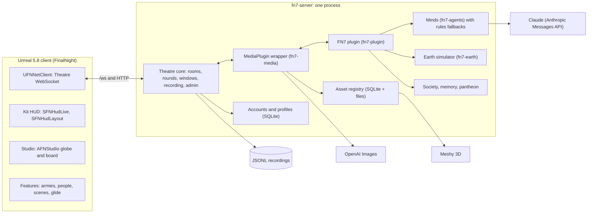

# Final Night 7: architecture

Final Night 7 is a multiplayer LLM game: an Unreal 5.8 client, and a Rust game plugin running inside **The Theatre**,
our server engine. The server is authoritative: clients never simulate rules. An LLM-driven Dungeon Master resolves
what players write, and every LLM call has a rules fallback, so the game plays (and replays) with or without a model.
Designers: Chris and her brother Benito.

Sources: `README.md`, `docs/PROJECT_GUIDE.md` §4–5, `docs/TIME_TRAVEL.md`, `docs/EARTH_SIM.md`, `docs/MEDIA.md`,
`docs/ASSETS.md`, `docs/ACCOUNTS.md`, `docs/DATA_MODEL.md`, `docs/ENGINE_SYNC.md`, `docs/DM_RULEBOOK.md`, `BUILDLOG.md`,
`crates/*/Cargo.toml`, and the Unreal repo `Source/FinalNight`.

## The system

The Theatre owns **when** (timers, seats, sessions, bots, windows, the event log, networking). The plugin owns
**what** (rules, views, summaries). The plugin's state is one opaque JSON value to the core: the whole
`fn7_model::World` (PROJECT_GUIDE §4.2).

## The Theatre core

- **Rooms and rounds.** One Theatre round is one beat: Start → Brief → Compose → Resolve → Reveal → Commit. The plugin
  implements the public `GamePlugin` API only: settings, the round hooks, `validate_action`, `resolve_round`,
  `commit_round`, views, `summarize`, `on_seat_takeover` (mid-match join) and the `game.*` queries.
- **Windows and instant actions** (engine v2.2). `action.begin` opens a slow-time window, the opener's Enter closes it
  and later submits are cut privately; the window's real open time reaches the plugin as `RoundContext.windows_closed`,
  so Time bills by the second. Casts, summons, challenges and duel lines are instant actions in any phase, stamped
  with `received_at_ms` and `seq`.
- **Recording.** The core records every match as `<match_id>.jsonl`: run start and end, rulesets, every core and plugin
  event, every hook's input and output, LLM calls, three state snapshots per beat, and at `full` the protocol frames
  and raw LLM HTTP (never credentials). JSONL is the store of record; `fn7-project` loads it into SQLite.
- **Replay.** `fn7-sim --replay <recording>` re-executes a match from its first (or `fork`) snapshot, answers every LLM
  call from the recording (the engine's `ReplayLlm`), feeds each round its recorded actions and context, and compares
  every snapshot and the summary byte for byte. `THEATRE_REPLAY_FROM` does the same in the server.
- **Fork and the admin API.** With `THEATRE_ADMIN_TOKEN` set, `/admin/matches`, `/recording`, `/timeline`,
  `/state?after_round=N&view=raw|public|seat:N` and `POST /admin/fork {match_id, after_round}`. A fork is a new
  private room that resumes after round N; bots take seats nobody resumes; its recording points at its parent.
- **Not yet in the engine** (requested, ENGINE_SYNC / BUILDLOG): a room-wide hold so a duel freezes the world (until
  then the world keeps beating during a duel), and `room.rewind` for a lone dead player's time travel.

## The FN7 crates

Dependencies point one way. Game rules never touch I/O, and LLM minds never mutate state: they return proposals, and
only the merge in `fn7-plugin` applies effects.

| Crate | Owns |
|---|---|
| `fn7-model` | Every type in the game state (World, ledger, memory, agents, gods, intents, effects, beats). No logic, no I/O |
| `fn7-society` | Clusters, memorization, the Venn of groups, rumor spread, mood and allegiance, ledger writes. Pure and deterministic |
| `fn7-memory` | Per-mind memory stores, recall for prompts, folding old memories into summaries |
| `fn7-pantheon` | The seven gods (`data/pantheon.json`), the power palette (`data/powers.json`), keyword routing, favor, prices, precedence |
| `fn7-agents` | Every LLM mind as a pure async function with a rules fallback; `runner::run_minds` runs a beat's calls concurrently with timeouts |
| `fn7-plugin` | The `GamePlugin`: beat loop, merge, flow and slow time, casts, duels, views, payloads, queries, hints, token play |
| `fn7-earth` | The Earth simulator's pure core: a low-resolution hex-column voxel field, phenomena, one beat's step, keyframes |
| `fn7-duelsim` | The duel's physics baked on the server: masses from materials, a deterministic rigid-body engine, limb targets for the client's IK |
| `fn7-media` | Images: house-style prompts, generators (mock, OpenAI Images; off by default, budgeted), a content-addressed cache, `/media` routes |
| `fn7-assets` | The asset registry: every image and 3D model as content-addressed files plus one SQLite database, `/api/assets` |
| `fn7-profile` | Persistent player identity: profiles, demigod identities, match history, library and time-travel links, in SQLite |
| `fn7-server` | The Theatre server with FN7 compiled in; `fn7-sim` (in-process matches, replay verification); the Claude backend; accounts; `/sim/*` |
| `fn7-tools` | Agent playtests, client JSON Schemas, the JSONL → SQLite projection |

## LLM use

- **Model:** Claude over the Anthropic Messages API (`claude-haiku-5-5` by default, effort `low`, at most 8 in
  flight), or the core's OpenAI-compatible gateway. With neither, **every mind uses its rules fallback**. Room setting
  `llm: false` never calls a model. Keys live only on the server.
- **The minds** (`crates/fn7-agents`): the hands (each player's two orchestrators), steps (subagents, possessions,
  paladins), gods, the resolver (the DM), the narrator, materialize (people brought forward from crowds), fold
  (memory summaries), generals, ramifications (one call per region with casts), the summon line, the duel's deed and
  move picker, moderation of player text, and the optional token-play caption polish.
- **Every call has a fallback.** `mind_timeout_ms` (6 s by default) per call: a late call takes its rules fallback. A
  resolve that fails twice becomes a rules-only beat (`fallback_outcome`).
- **The DM never contradicts itself.** Every act's d20 is seeded and recorded; a proposal (the LLM's or the rules')
  that disagrees with its act's roll is corrected and logged as `memory_conflict` (DM_RULEBOOK §4.2).
  Prompts carry the place's settled facts and, from schema 17, one line of what the earth holds there.
- **Replayed from recordings.** Every LLM request and answer is recorded, so a replay needs no model and spends
  nothing.

## The Earth simulator

A server-side, deterministic, low-resolution voxel field of the whole planet (EARTH_SIM.md). Every mega, mini,
god-tier power and physical ramification starts a **phenomenon** (storm, volcano, rupture, drifting plate, flood ...),
each a small cellular automaton; all of them step together every beat and interact through the cells they share.
Entropy speeds it up (more sub-steps, spontaneous quakes and freak weather; heat death makes every phenomenon flare).
Its consequences go **through the existing rules**: capped damage to demigods, fear and deaths in crowds, ruined
settlements, cut roads, toppled shrines, and `earth.*` memories. From schema 20 it names each thing it touched
(crowds running to shelters, shelters breaking, forests burning cell by cell) and keeps **scars** at every zoom. Any
past beat is rebuilt from keyframes (one every 16 beats) and the input log.

## The memory hierarchy

- **The DM's place × time memory** (`World.dm.memory`): every decision is an append-only entry with its beat, place
  and ancestors. Places nest: cell (people 3 m, houses 30 m, villages 3 km, regions 120 km) → settlement → region →
  world.
- **Integrate:** each beat the DM rolls new facts up the hierarchy (`memory.rollup`), so a coarse zoom reads the truth
  of everything beneath it.
- **Compare:** a question already answered keeps its recorded answer.
- **Extrapolate:** a hex is known only when someone looks. Zoomed into, its state is extrapolated from its last
  observation, then recorded: detail exists once observed and is then remembered.
- **The minds' memories** (`fn7-memory`): one store with many owners (hands, subagents, gods, characters, crowds),
  recall ranked by topic overlap → salience → recency, no embeddings; past 40 per owner, old ones fold into summaries
  (the originals stay in the recording).
- **The tree of consequence** (`game.memory_tree`) shows all of it, read-only, to any client (FLOWS.md §10).

## Media

- **Images** (`fn7-media`, off by default, budgeted): portraits, demigod dioramas, items, event moment cards, statues,
  places, armies, and a library of 48 people sprites and 24 buildings. Two looks chosen per kind: Benito's dark
  fantasy for portraits, and the max-zoom hex diorama (a sparse low-poly miniature on a candlelit table) for the rest,
  each with his reference images. Every character has a stable visual sheet. Generation runs in the background and
  never holds up a beat; clients poll a manifest.
- **Meshy 3D statues through the backend:** the god form's accepted image becomes an image-to-3D statue, one per
  account; every Meshy call goes through the backend into the registry (BUILDLOG: 94 calls, 1,011 credits imported).
- **The SQL asset registry** (`fn7-assets`): content-addressed files plus `assets.sqlite` with every provider call's
  exact prompt, parameters, timing and cost, what it was made from (lineage), and where it was shown (which match,
  beat and demigod). `GET /api/assets/at?match=&beat=&demigod=` answers what a demigod looked like at any beat.

## Accounts and profiles

- **SQLite** profile store. Guests need no setup (`POST /api/auth/guest`); Google sign-in is optional and a guest can
  link it. Sessions are opaque tokens stored only as hashes, sliding 90 days. An email is returned only to its own
  account, never in a payload, recording or log line.
- Each account has settings, two demigods (custom name, personality, style, creed; one moderation pass) and a god
  form. `POST /api/game/bind` ties a WebSocket seat to the account; a name an account holds is reserved for it.
- Profiles keep each player's match history with links back into the recordings to scrub or fork.

## The Unreal client's layers

| Layer | What it is | Classes |
|---|---|---|
| **Network** | The Theatre protocol over WebSocket, plus HTTP queries | `UFNNetClient` |
| **The kit HUD** | The style kit and the live HUD, mounted by a subsystem, driven by every server message | `SFNHudLive` (model from messages), `SFNHudLayout` (header, WORLD scroll, seat cards, powers, WILL and its hot buttons), `SFNStartPanel` (lobby), `SFNAccountPages`, `SFNChat`, `SFNDuelTray`, `SFNMemoryTree`, `SFNPowerTile` / `SFNPowerIcon`, `FNStyle`, `FNHudSubsystem` |
| **The studio** | The table: the globe, the board, the camera and the hand-of-god controls | `AFNStudio`, `AFNPlayerController`, `FNPlanet`, `FNEarthPlay` (the earth field), `AFNTableGods` (the pieces), `FNPowerRing`, `FNStarBackdrop`, `AFNGodStatue`, `FNDuelBox` / `FNDuelStage` |
| **Features** | World life drawn from server data | `FNArmies`, `FNBoardLife`, `FNPeopleLife`, `FNHouseCards`, `FNSettlements`, `FNShrines`, `FNEncounters`, `FNDayNight`, `FNInventoryShelf`, `AFNScenePlayer` (token play), `AFNEventGlide`, `FNEventFx`, `FNTurnBar`, `FNYouMarker` |
| **Sound** | The narrator's voiceovers and the sound pass | `FNVoiceOver`, `FNSoundPass` |

Two deliberate styles (Benito): the god's room realistic (marble statues), the board and the earth the gods' toys.

## Determinism and time travel

- **Seeded everything.** All randomness is SplitMix64 from the match seed; every d20 is seeded by the seed and its
  question (`Rng::derive(seed, [0xD20, hash(query)])`), so the same question always gets the same roll. No hash maps in
  anything that affects output; floats round-trip exactly.
- **Exact resume** (schema 8+): the present is the state at the last resolve plus the journal of instant actions since.
  A reconnecting client or a viewer joining mid-duel gets the exact present in one message. A `kill -9` loses **0**
  accepted instant actions (the journal is on disk before the next one is taken), and a duel's clock counts only time
  the room was running (TIME_TRAVEL.md §7–8).
- **0-difference replays.** Every rules change is gated on the state's schema number, so older recordings replay
  unchanged.

## Numbers the docs state

| What | Number | Source |
|---|---|---|
| Replays of the three newest LAN recordings after the next-move release | 121/121, 162/162, 159/159 snapshots identical, 0 differences | BUILDLOG 2026-11-15 "the next move" |
| Replays after token play, and a schema-19 sim | the same three 0 differences; 24/24 identical | BUILDLOG "the tokens play the will" |
| Replays after earth effects, and a schema-20 sim | 162 + 159 + 162 identical, 0 different; 90 identical | BUILDLOG "what the earth did" |
| Instant actions lost to a `kill -9` | 0 (three runs) | TIME_TRAVEL.md §8 |
| `game.*` queries | median ≤ 2.2 ms each on a planet at beat 50, release | ENGINE_SYNC.md |
| `game.memory_tree` | ~2.3 ms median at beat 50 (1,631 DM entries, 11,316 memories), held under 5 ms | BUILDLOG "the tree of consequence" |
| `game.people` / `game.buildings` | ~0.9–1.1 ms / 0.1–0.3 ms median at beat 50 | BUILDLOG "people and houses" |
| Live typing relay in a duel | median 20 ms, 95th percentile 30–75 ms | CLIENT_API.md |
| Duel odds | 600 seeded trials of the blow rule per query | BUILDLOG "the next move" |
| Earth powers verified | all 11 powers × mega/mini on a private no-spend server | BUILDLOG 2026-11-15 |
| Tests at the challenge-mode merge (rules 0.8.1) | 286 tests, replays clean | BUILDLOG 2026-11-14 |
| Packaged Win64 build (dry run) | 8 min 20 s, 575 MB | Unreal docs/PACKAGING.md |
