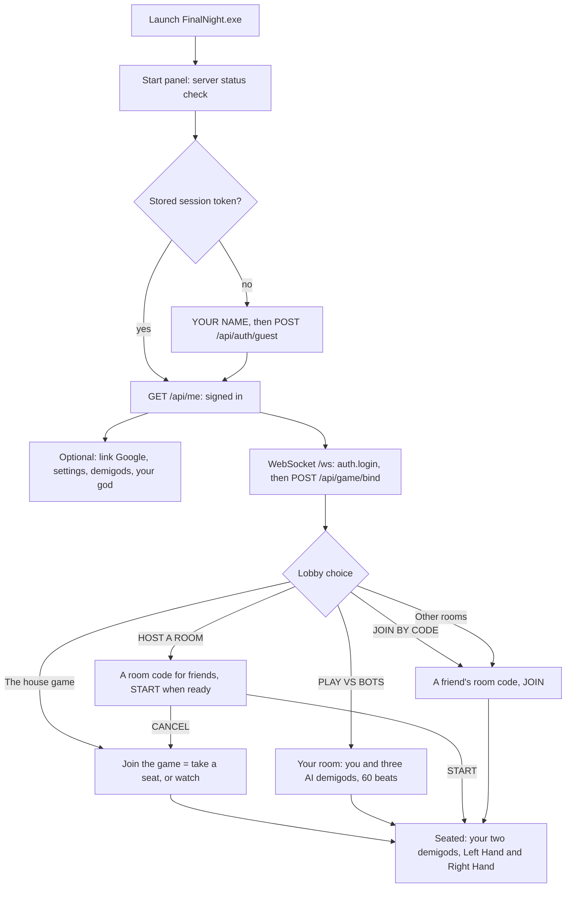
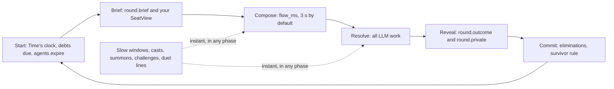
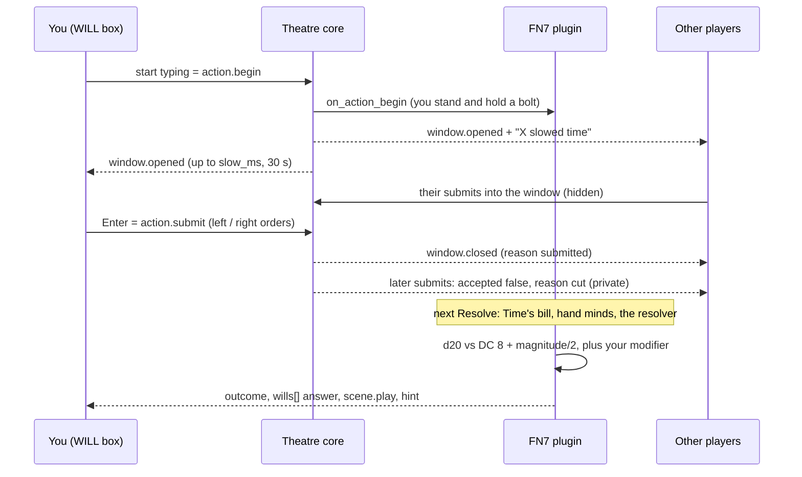
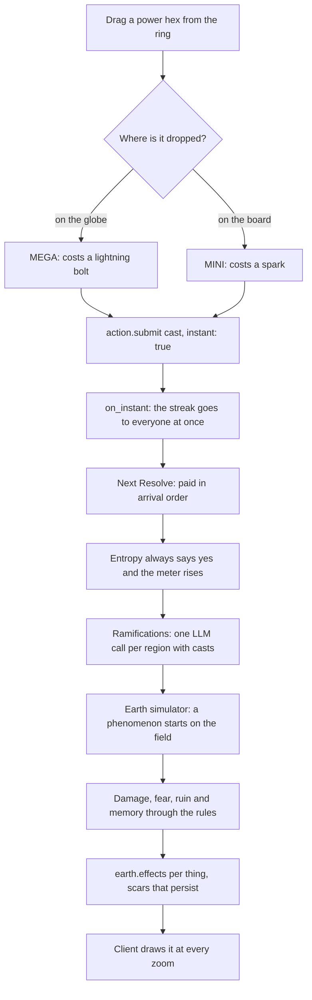
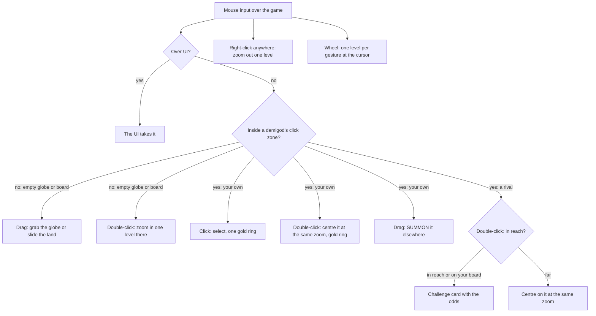
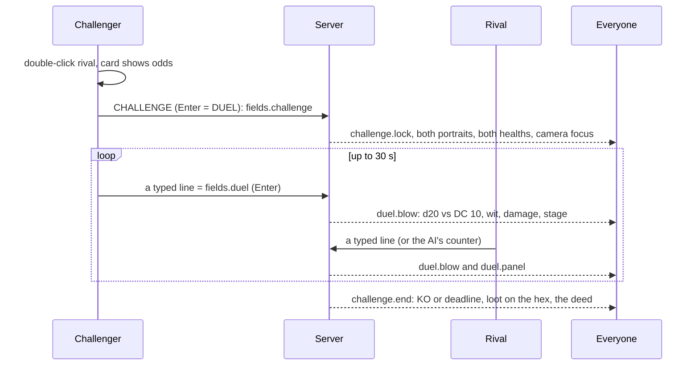
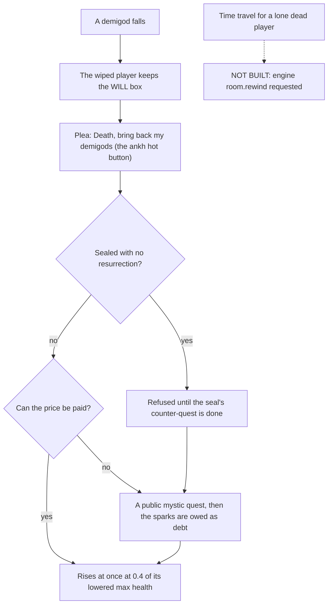
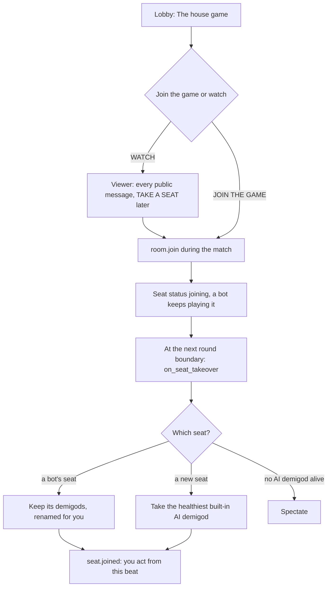
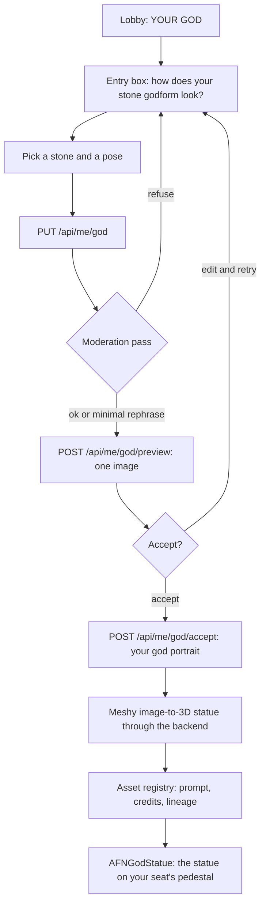
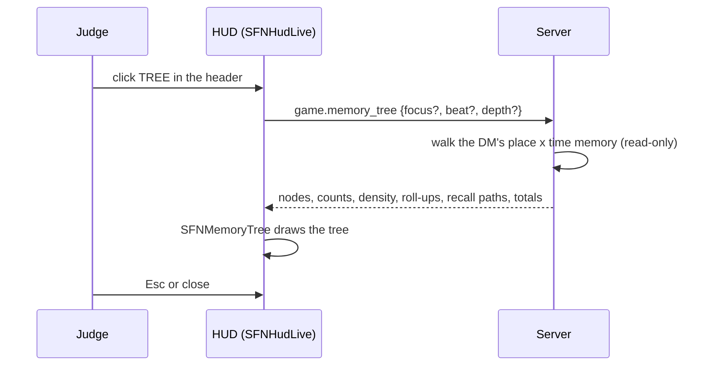

# Final Night 7: the flows

Ten flows through the game, from the first launch to a judge opening the tree of consequence. Each one has a diagram,
a short explanation and the exact gestures the Unreal client takes. The server is authoritative: the client draws and
sends gestures, and the Rust plugin on The Theatre decides. Designers: Chris and her brother Benito.

Sources: `docs/DM_RULEBOOK.md` (rules 0.8+), `docs/CLIENT_API.md`, `docs/ACCOUNTS.md`, `docs/EARTH_SIM.md`,
`docs/TIME_TRAVEL.md`, `BUILDLOG.md`, `README.md`, and in the Unreal repo `docs/design/hand_of_god/HAND_OF_GOD.md`,
`docs/design/EVENTS_IN_THE_WORLD.md`, `docs/DUEL_UNREAL.md` and `Source/FinalNight`. Anything not built is marked
**NOT BUILT**.

---

## 1. First launch → login or guest → lobby → take a seat

- A guest needs no setup, email or password: one `POST /api/auth/guest` with a display name returns a session token
  the client keeps; every later launch is `GET /api/me` (ACCOUNTS.md §3). LINK GOOGLE keeps a guest's history.
- After `auth.ok` the client calls `POST /api/game/bind`, so the seat gets the account's demigod names and personas
  and the match goes into the account's history. A name an account holds is reserved for that bound account.
- The house game is the server's single always-on game: AI seats, mid-match join always on, restarting itself after
  each match. Clients find it with `GET /api/house` (flow 8).
- CANCEL while hosting closes your room and puts you straight back into the house game (`SFNStartPanel::CancelHosting`;
  BACK TO THE GAME while hosting does the same).
- **Gestures:** type your name; click Join the game, Watch, Play vs bots, Host a room (then Start or Cancel), Join by
  CODE or a JOIN on an OTHER ROOMS row. **Esc** opens and closes the lobby during play. A viewer has a TAKE A SEAT
  button in the HUD.

---

## 2. The beat loop: the world never waits

- One Theatre round is one beat. The beat runs Start → Brief → Compose → Resolve → Reveal → Commit (DM_RULEBOOK ch. 17);
  there is no Choose phase.
- Resolve, in order: Time's bills → casts → hands → mentions → route → one batch of minds → merge and world rules →
  the society → occupancy → the DM's step → consequence and memory.
- The world runs in flow beats whether anyone types or not. Typing slows time for everyone but never stops it (flow 3).
- Beat 1 is the Final Wish (more acts, +2 magnitude, +2 on its d20s). The Final Night falls on `beats_total` (60 by
  default), at heat death (Entropy 100) or when nobody would be left standing; exactly one player survives. The last
  player standing wins.
- Every beat each human seat also gets a **next-move hint** (`hint {text, why, action, target, urgency}`) and a goal
  line such as "Last standing wins. You: 2 alive, 3 rivals. Beat 41 of 60." (DM_RULEBOOK ch. 29).
- **Gestures:** none needed. The game plays on. The turn bar and the WORLD scroll show the beat and the news.

---

## 3. A typed will: slow time, Enter, the d20, the outcome

- Starting to type opens Time's slow window for the whole room; the world keeps resolving in flow beats underneath.
  Everyone is told who slowed time. Others may still slip orders in, hidden, until your Enter closes the window; anyone
  slower is cut off privately (CLIENT_API "Real-time input").
- Time's bill at the next resolve: one bolt as a toll, a debt `0.5 × (1 + seconds/10) × (1 + 0.5 × recent slows)` and
  Entropy `0.5 + seconds/30` (DM_RULEBOOK §12.2). So the longer you hold time, the more it costs.
- Your words go to your two hands (LLM orchestrators). Each act is rolled: one d20 against DC 8 + magnitude/2 with the
  demigod's modifier (+1 hale, −1 badly hurt, plus half its wardrobe stage). Natural 1 = `crit_fail`, natural 20 =
  `crit_success`. Every die is seeded by the match seed and the question, so the same question gets the same roll.
- What comes back: the outcome lines, your will's answer (`round.private.wills[]`), a **token-play scene**
  (`scene.play`: the demigod's token walks, enters, talks; the d20 tumbles; success, partial, failed or twisted; at most
  8 steps, about 8 s), and the next-move hint. The order's words never appear in public.
- **The four WILL hot buttons** (icons, no text: ankh, bow, meal, armies). A press puts its line in the box, replacing
  what is there ("Death, bring back my …", "arm yourself with an obsidian blade in … and hunt …", "Nature, heal my …",
  "raise an army of 10,000 fishermen at the harbour of …"). The WILL then waits **5 s** and sends itself, as Enter
  would. Those 5 s are the other speed-typers' window. Any edit to the line stops the auto-send (it is your will then).
  Code: `SFNHudLayout::MakeWillChips` and `Tick`.
- **Gestures:** click into the WILL and type (`r:` sends a line to the Right Hand); **Enter** sends. Or press a hot
  button and wait 5 s, or edit the line.

---

## 4. Casting a power: drag a hex onto the globe or the board

- The tier is set by where the hex drops: on the globe it is a **mega** (map scale: radius × 4 within 600–2,500 km,
  magnitude + 2, a bolt, and every other player gains a bolt), slid onto the board it is a **mini** (radius / 20
  within 3–30 km, magnitude − 3, a spark, gifts nothing). Mega Entropy +10, mini +1. Megas are scaled by the nearest
  fault line (DM_RULEBOOK §12.3, ch. 13).
- The cast is an instant action: everyone sees the streak at once (`phase.event` Streak). It is paid at the next
  resolve in arrival order; a player can spend at most what it held at the beat's start. At Entropy 40+ a third of
  casts land 50–400 km off target.
- **Ramifications:** one call per region with casts, giving geotagged rows and lasting world mods.
- **The Earth simulator** turns every mega, mini, god-tier power and physical ramification into a phenomenon (storm,
  volcano, rupture, flood ...) on a deterministic voxel field of the planet. It steps once a beat, and its
  consequences go back through the rules (EARTH_SIM.md): demigods take a capped hit, crowds flee to shelters, strong
  hazards break shelters, forests burn cell by cell, roads are cut, shrines topple, settlements shrink.
- **Visible effects:** `round.outcome.public.earth.effects` names each thing touched (`{cell, level, thing, what,
  count, cause, power, seat}`). The client draws the field (`FNEarthPlay`), board life and event effects, and glides
  the camera to **your own** events and back (`AFNEventGlide`: about 4 s for a disaster, never while you grab, pan,
  zoom or type). Damage persists and heals slowly.
- From state schema 22 a cast that hits your own standing demigod carries `own_hit`, and the next beat's hint warns you.
- **Gestures:** press a power hex, drag, release on the globe (mega) or the board (mini). Over the board the gold
  target hex and the orange area of effect show where it lands.

---

## 5. The controls (locked in HAND_OF_GOD §6, plus today's demigod rules)

- **Grab:** press and move on the globe and the grabbed point stays under the pointer; press on empty board and the
  land slides under the hand for the whole drag. The pressed hex stays within 3 px of the pointer (measured). No camera
  motion during a grab, no rebuild under a moving hand. The game uses the system mouse pointer.
- **Click:** a press that moves under 20 px within 0.6 s is a click: on the globe it goes where you click (dives to that
  region). On a demigod's card or piece it selects it (one gold ring under the piece; nothing moves).
- **Double-click your own demigod** (portrait or piece, the same gesture): the board and globe glide to centre it at
  the zoom you are at, with one gold ring pulse.
- **Double-click a rival:** in reach (the two pieces touch, or within max(120 km, the zoom's contact distance)) or on
  your board, the challenge card opens with `game.duel_odds`; out of reach but on the board, the card says your
  demigod teleports beside it first (about −1 to −2 health). Far away: the view centres on it (a red ring pulse).
- **Right-click** zooms out one level, animated; a demigod never eats it. **Wheel** zooms one level per gesture.
  **Drag your own demigod** = summon it (an instant `fields.summon`, once a beat, a visible mishap d20 first, DM_RULEBOOK
  ch. 19); dragging a rival does nothing. A demigod's items open only from the **ITEMS** button on its card.
- The UX is frozen as Chris approved it: any change to input, pan, zoom or the board's rebuild path needs a 60-second
  live drag-and-zoom test in her editor first (HAND_OF_GOD §6). Code: `AFNPlayerController`, `SFNHudLive::OnDemigodDoubleClick`, `AFNStudio`, `AFNTableGods`.

---

## 6. Challenge and duel: will against will

- A challenge is forced (no consent). It is refused when not yours, fallen, not a rival, too far, busy or on
  cooldown. Accepted, every client sees `challenge.lock`: a lock-in slam, the camera swoops to the fight, and the box
  opens on the table (DUEL_UNREAL.md).
- **The world holds its breath, by design.** The engine's room-wide hold is **NOT BUILT** yet (`ENGINE_HOLDS = false`):
  for now the world keeps beating underneath, the two duellists are locked in place, and the duel lasts up to 30 s
  (`duel_deadline_ms`). The lock says `world: "beating"`.
- **Blows:** every Enter is a blow, resolved at once by rules: a d20 against DC 10 (+1 at night, + half the opponent's
  wardrobe stage), with the line's **wit** (−3..+4: action verbs, a body part, an item you hold, a terrain word, the
  opponent's scars; repeats and gibberish cost) and situation modifiers. Damage 0 on a fail, 1–3 on a success, 4 on a
  natural 20. Faster than 2 a second is a penalty.
- **Duel words** (schema 21): each Enter plays at once ("roll left", "jump", "hide behind that tree then pop up and
  slit his throat", up to 4 staged steps). Only things you hold, or that stand on the board or the ground, can be used;
  naming something you lack is a whiff.
- **The end:** knockout, deadline, a duellist falls elsewhere, or both are AIs. The damage lands; at a knockout all the
  loser's loot falls on the duel's hex (otherwise a DC 11 roll to keep its newest thing); both get the duel's **deed**
  as a tale and the hex remembers the fight.
- **Gestures:** double-click a rival in reach, then **Enter** (or DUEL) on the card. In the tray (`SFNDuelTray`), type a
  line and press **Enter**, again and again. Typing is masked for both sides.

---

## 7. Death: the plea to Death (and what is not built)

- Any player may plead for any fallen demigod; a wiped player may plead, ask about quests and make offerings, and
  nothing else (DM_RULEBOOK ch. 25).
- **Death's price:** sparks `5 × (1 + times raised) + 1 per 8 beats dead`, and years off its max health for good. All
  or nothing. If it can't be paid: a public quest (1–3 steps the engine verifies), and the raised demigod owes Death the
  sparks as a debt. At most 3 raisings per player per match.
- A **seal** (no resurrection) refuses every road back until its counter-quest is done; every curse has a counter.
- Death's god-tier power "The Pale Verdict" raises a fallen target (DM_RULEBOOK ch. 20).
- **Time travel for a lone dead player is NOT BUILT.** The rule Chris set: a dead player who is the only active human
  may rewind and fork the match from an earlier beat. It needs the engine's `room.rewind`, requested and not built
  (BUILDLOG, 2026-11-15). (Admins can already fork any recorded match after any round, flow 10 / ARCHITECTURE.)
- **Gestures:** press the ankh hot button (auto-sends in 5 s) or type the plea and press **Enter**.

---

## 8. Mid-match join and the house game

- The house is one always-on game with AI seats and mid-match join on; it restarts itself after each match. It has an
  attract replay, forks on interaction, and away seats can be reclaimed by name (BUILDLOG).
- A joiner gets `room.snapshot` and `match.snapshot` at once to draw the table, then binds at the next round boundary
  (CLIENT_API "Joining mid-match"). A player who leaves is replaced by a core bot; another human may take that seat.
- Known issue (BUILDLOG): through the house's attract fork a joiner can inherit a seat that is already dead at the
  current beat. The fix asked for is player time travel (flow 7), not built.
- **Gestures:** Join the game (or watch, then take a seat).

---

## 9. The god form: describe your god, see it in stone

- The entry box takes the player's own words (≤ 600 characters). Stones: white marble (default), black onyx, granite,
  sandstone, jade, bronze, gold leaf, or your own words. Poses: The Thinker, David, Moses seated, the Discus Thrower,
  Atlas, Winged Victory, the Boxer at Rest, or custom (ACCOUNTS.md §14).
- **Moderation:** one pass (claude-haiku-5-5, with a rules-only fallback): ok verbatim, minimal rephrase, or refuse
  (422). Personal data is always handled by rule.
- **Preview:** one 1024x1536 image in the house's marble-statue style; (description, stone, pose) is the cache key, so
  a repeat is free; 6 new pictures per account per day.
- **Accept:** the image becomes the account's god at once; the Meshy statue (one per account) is made through the
  backend and recorded in the asset registry. Meshy statues were switched **on** on 2026-11-15 (BUILDLOG).
- Any client at the table asks `GET /api/assets/figures?name=<player>`: the accepted image, then the statue when
  ready, else the house's marble god. `AFNGodStatue` builds the statue at runtime from the GLB (≤ 80k triangles),
  in the chosen stone's colour.
- **Gestures:** YOUR GOD in the lobby menu; type, pick stone and pose, preview, accept.

---

## 10. A judge opens the tree of consequence

- The tree is the DM's memory as the exact tree it is: world → region → settlement or open country → villages hex →
  houses hex → people hex, and beside it a city's society branch (district → crowd → cell → person).
- Every node counts its facts (here, rolled up, private), their density (log10 per km², from about −5.5 for the
  planet to +6 for a 3 m hex), first and last beat, kinds, samples, and the `memory.rollup` citing exact entry ids.
- **Recall paths** show how one fact reaches a prompt: a d20 (its key, the seeded die reproducing the stored face, the
  roll-ups citing it, the real prompt lines), an encounter chain, an earth event, a person's memory.
- Private entries are counted, never shown. Median about 2.3 ms at beat 50 in release (held under 5 ms by a test).
  Also over HTTP: `GET /api/rooms/{code}/query/memory_tree`.
- **Gestures:** click **TREE** in the HUD header; **Esc** or CLOSE shuts it.
